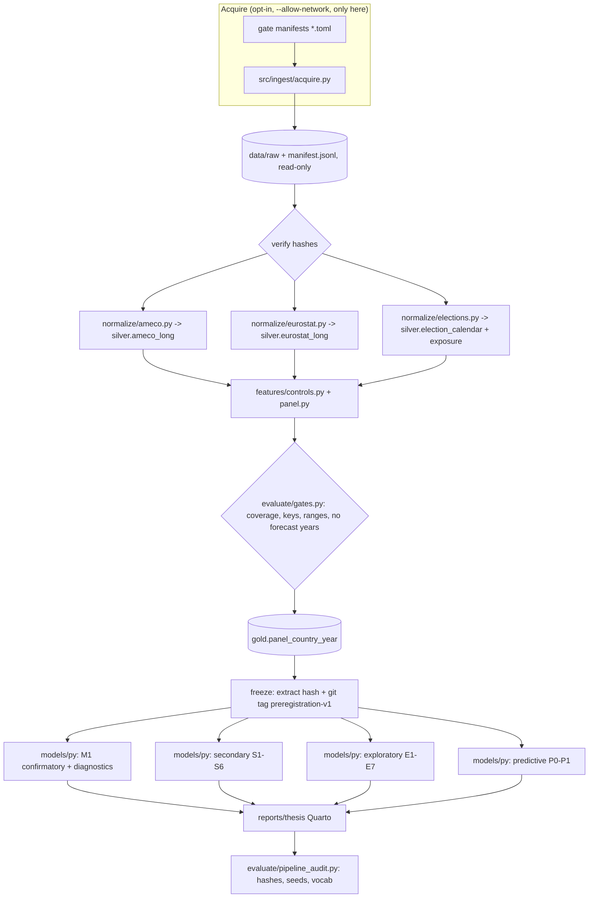

# Stage C: Implementation blueprint

Status 2026-10-10. Built on the gate results in [decision_log.md](decision_log.md). Gate 1 (AMECO pin) and Gate 2 (fiscal-rule audit) and Gate 3a (calendar and sample) are complete; Gate 3b (power) is summarised in section 7. This is a blueprint: nothing in sections 2–6 below is implemented unless marked **exists**. Machine-readable parts live in `config/`.

Environment (installed and verified 2026-10-11): Python 3.14.3 in a project virtual environment `.venv` (gitignored), locked in `requirements.lock` (73 packages, hashed, universal; direct dependencies in `requirements.in`): pandas 3.0.2, numpy 2.4.4, scipy 1.17.1, statsmodels 0.14.6, linearmodels 7.0, scikit-learn 1.8.0, pyarrow 24.0.0, duckdb 1.5.3, matplotlib 3.10.8, seaborn 0.13.2, pytest 8.3.4, and the Jupyter stack for Quarto (ipykernel 7.4.0, nbformat 5.11.1, nbclient 0.11.0, jupyter_client 8.10.0). **Project rule (researcher, 2026-10-10): Python only, no R; the thesis is a Quarto document.** Quarto 1.10.19 (official release zip, SHA-256 checked against the published checksum) is installed at `%LOCALAPPDATA%\Programs\Quarto\1.10.19`; PATH and other system settings were not changed, and `scripts/quarto.py` finds it (QUARTO_PATH, then PATH, then that folder) and points its Python engine at `.venv`. A smoke render executed code cells, embedded a 300-dpi figure and produced HTML and a Typst PDF (Quarto bundles Typst, so no LaTeX is needed). Not installed: `pyfixest`, `arch`, `shap` (not needed yet).

## 1. Repository tree

`exists` = already in the working tree and tested; the rest is planned for the milestone shown.

```text
Fiscal_Deficit/
├── README.md                          # M1: purpose, one-command reproduction, data licences summary
├── LICENSE                            # M1 (R07): code licence; data licences are separate
├── Makefile                           # M1: acquire (opt-in) | ingest | panel | models | report | audit
├── requirements.in  requirements.lock # exists: uv-locked, hashed, universal; `.venv` is gitignored (no R)
├── .github/workflows/ci.yml           # M1: single `on:` block, actionlint test (R08)
├── config/
│   ├── countries.csv                  # exists: single EU-27 crosswalk (EL, GRC, ROM, ...)
│   ├── acquisition/                   # exists: gate1..gate3 (acquired), gate4 (pending approval)
│   ├── contracts/contracts.toml       # exists: bronze/silver/gold schemas
│   └── registry/{confirmatory,secondary,exploratory,predictive}.toml   # exists
├── data/
│   ├── raw/        # exists: 16 hashed read-only files + manifest.jsonl per source (never edited)
│   ├── interim/    # exists: election_calendar_eu27.csv, exposure_eu27.csv, ameco snapshot json
│   ├── processed/  # M3: gold/panel_country_year.parquet + frozen_extract.sha256
│   └── external/   # literature PDFs; LICENSES.md (M1, R07)
├── src/
│   ├── ingest/acquire.py              # exists: opt-in network layer (ADR-001), 17 tests
│   ├── normalize/{ameco,countries,elections}.py   # exists
│   ├── normalize/eurostat.py          # M2 (R01): SDMX-CSV reader, flags kept, negatives kept
│   ├── features/{controls,panel}.py   # M2/M3: ig_diff, EOADR, gold panel assembly
│   ├── evaluate/{sample,power}.py     # exists (Gate 3)
│   ├── evaluate/gates.py              # M2 (R03): failing coverage/contract gates
│   ├── evaluate/{seed_audit,pipeline_audit}.py    # M7 (R15)
│   ├── models/py/{panel,m1_confirmatory,diagnostics,secondary,exploratory}.py   # M3-M5
│   ├── models/py/{wild_bootstrap,predictive}.py   # M4 / M6
│   └── export/tables_figures.py       # M4-M7: 300 dpi figures with source line
├── scripts/
│   ├── run_pipeline.py                # M1 (R12): stage runner (Python only)
│   ├── summarise_ameco_snapshot.py    # exists
│   └── probes/                        # throw-away; gate2_fgd_audit.py exists; feasibility_probe.py to move here
├── tests/                             # exists: 109 tests passing on 2026-10-10 (see section 5)
├── reports/                           # proposal, appendices A-D, gate reports, thesis/ (Quarto, M7)
└── docs/
    ├── decision_log.md  stage_c_blueprint.md   # exists
    ├── adr/                           # ADR-001 acquisition (in decision log), 002 vintage pinning, 003 exposure, 004 DuckDB/Parquet not Delta, 005 wild bootstrap implementation
    └── amendments.md                  # M3: post-freeze changes, if any
```

## 2. Source manifests and data contracts

**Acquired and hashed (Gates 1–3):** AMECO Spring 2026 (zip plus five SDMX extracts, DSD, help, metadata), EC Fiscal Governance workbooks, ETAD, ParlGov `view_election`, Eurostat `demo_pjanind`. Each has a `manifest.jsonl` line with URL, size, SHA-256, retrieval time and headers.

**Acquired 2026-10-10 on approval (Gate 4):** [config/acquisition/gate4_controls_and_secondary.toml](../config/acquisition/gate4_controls_and_secondary.toml), six files, 0.89 MB in total (my 2.6 MB estimate was too high), all hashed and read-only: `gov_10a_main` (B9, D41PAY, TR, TE, D62PAY, D632PAY), D41PAY in million euro, COFOG, EDP debt in % GDP and million euro, nominal GDP; Needed for the lagged debt and interest-growth controls and all secondary outcomes. Not needed yet: V-Dem (a raw v16 file exists in `Spengler-Wallerstein-Dashboard`, gitignored, so it would be copied under a manifest), CPDS, DPI, `demo_pjanbroad` and `lfsa_egan` (for EOADR).

**Contracts:** [config/contracts/contracts.toml](../config/contracts/contracts.toml) defines `bronze.raw_file_manifest`, `silver.ameco_long`, `silver.eurostat_long`, `silver.election_calendar`, `silver.exposure_country_year` and `gold.panel_country_year` with keys, types and rules. Key rules: AMECO ratios carry the official denominator text; negatives and flags are preserved; the exposure table never contains CAPB; the confirmatory extract has exactly 715 rows and 27 countries; coverage below 97 per cent or any retained country below 20 observations fails the build.

## 3. Pipeline dependency graph



Everything below `RAW` runs offline. `make reproduce` runs verify through audit from a clean clone; `make acquire` is the only target that may use the network and requires an explicit flag.

## 4. Exact confirmatory specification

Frozen in [config/registry/confirmatory.toml](../config/registry/confirmatory.toml); summarised here.

- **Sample:** EU-27, 1995–2021, N = 715 country-years, selected by the Gate 3a rule (start year is the lagged-moderator floor; end year is the last year with complete exposure). Sensitivities: 2022 extension (N = 737), balanced-22 (N = 594), drop unclassified elections (25 countries, N = 633).
- **Outcome:** `capb` = AMECO `UBLGBP`, percentage points of potential GDP, surplus positive, Spring 2026 vintage, pinned and tested (`tests/test_ameco_metadata.py`).
- **Exposure:** fractional 12-month pre-election windows by class: `W_S` (scheduled), `W_E` (early), `W_D` (delayed), `W_U` (unclassified, kept as a separate regressor by default), plus `Post` (12 months after any election). Constructed from ETAD/ParlGov dates alone, before any outcome was merged.
- **Moderator:** `a_lag` = OLDDEP1 at *t*−1, standardised on the estimation sample; `abar_i` its country mean; `adev_it = a_lag − abar_i`.
- **Model M1:** `capb ~ W_S + W_E + W_D + W_U + Post + W_S:abar + W_S:adev + a_lag + controls_{t−1} + W_S × era | country + year`, with era dummies 1995–2007, 2008–2015, 2016–2021, **centred at their exposure-weighted sample means** so that β_S is the average association (uncentred terms make β_S the 1995–2007 effect, MDE about 1.8–1.9 pp: Gate 3b). Controls at *t*−1: output gap (`AVGDGP`), debt/GDP, interest–growth differential, euro membership.
- **Interpretations (decision 5):** `W_S:abar` = cross-country heterogeneity in the election association by average ageing level (potentially confounded by other country traits); `W_S:adev` = whether the association changes as a country ages relative to its own mean (expected to be imprecise). Neither is called the effect of ageing.
- **Hypotheses and multiplicity:** H1 (β_S), H2B (γ_B) and H2W (γ_W) form one Holm family of three (familywise α = 0.05). H2B and H2W are two-sided with no pre-registered direction.
- **Inference:** wild-cluster bootstrap-t by country (G = 27) is the headline p-value and interval; country-clustered CR1 with t(26) is reported alongside; Driscoll–Kraay and CCE are sensitivities. No lagged dependent variable and no GMM in M1.
- **Estimation and bootstrap (ADR-005, revised 2026-10-10: Python only):** estimation, CR1 inference and the wild-cluster bootstrap-t all run in Python. The vectorised fixed-effects engine already used for the power study (`src/evaluate/power.py`) is promoted to `src/models/py/` and cross-checked on the real panel against `statsmodels` (dummy-variable OLS with cluster covariance) and `linearmodels.PanelOLS` (entity and time effects; clustered and Driscoll–Kraay covariances). Diagnostics that no installed package provides (modified Wald, Wooldridge serial correlation, Pesaran CD, CIPS, CCE) are implemented in Python and unit-tested on simulated panels with known answers.
- **Diagnostics (reported, not used for selection):** modified Wald heteroskedasticity, Wooldridge serial correlation, Pesaran CD, CIPS unit-root tests on CAPB and the moderator, VIF (>5 flagged), Hausman with the Mundlak terms, binned-kernel linearity and common support for the interaction (Hainmueller, Mummolo & Xu 2019), lead placebo, Rambachan–Roth sensitivity if an event-study variant is run.
- **Freeze rule:** the registry, the exposure construction, the gold extract hash and the sample are committed and tagged `preregistration-v1` before any outcome model is run. Later changes are logged in `docs/amendments.md` and reported as post hoc.

## 5. Tests for known parsing and metadata defects

Current suite: 109 tests passing on 2026-10-10 (acquisition, AMECO metadata, crosswalk, elections, sample, the Stage C config checks, and the power-module tests written so far by the still-running Gate 3b agent; recount when it finishes). Remediation R01–R17 applies **only to this repository**; defects in the original repositories are listed in section 6 as issues, with the source commit SHAs of [Appendix C §1](../reports/appendix_C_repo_migration.md), and backporting is deferred.

| ID | Defect | Regression test | Status |
|---|---|---|---|
| R01 | Eurostat parsing drops negative values | `tests/test_eurostat_sdmx.py`: `-3.2 p`, `-0.5`, `: c`, `1 234.5 e`; a CAPB-like column keeps its negative count | **planned M2**; negatives already asserted in `tests/test_sample.py` |
| R02 | A 2SLS script named "System GMM" | static test: no file or output label contains "GMM" unless a `pgmm` call exists | planned M1 |
| R03 | Coverage checks only warn | `tests/test_gates.py`: a panel at 94 per cent coverage exits non-zero and writes no gold file | planned M2 |
| R04 | ISO crosswalk duplicated; Slovenia missing | `tests/test_countries.py` (27 members, SI and HR present, EL/GRC/ROM handling) plus a static test that no other module defines an ISO dictionary | **exists** (crosswalk); static test planned M1 |
| R05 | Manifest path-depth bug; date-only dedupe | `tests/test_acquire.py` (tamper, no overwrite, no duplicate provenance, size and content-type checks); add `verify_manifest()` | **exists** (acquisition); verifier planned M1 |
| R06 | READMEs claim sources or commands that do not exist | `scripts/check_readme_claims.py` runs in CI against this repo's README | planned M7 |
| R07 | No LICENSE; third-party data terms unread | CI fails if a file under `data/raw` or `data/external` has no row in `data/external/LICENSES.md`; terms read from providers (ETAD dataset licence, AMECO, EC FGD, CPDS, IMF are unverified) | planned M1; needs your decision on redistribution |
| R08 | Duplicate `on:` key in CI | `actionlint` and strict-YAML load of the new workflow | planned M1 |
| R09 | Unpinned environment | `uv lock --check` (or the equivalent pinned-environment check) in CI | planned M1 |
| R10 | `GR` vs `EL` mismatch | covered by `tests/test_countries.py` | **exists** |
| R11 | `NaN` emitted as invalid JSON | strict-JSON export test | only if the dashboard stretch is built |
| R12 | Hard-coded paths | static test: no `C:\` or `/Users/` in `src`, `scripts`, `config` | planned M1 |
| R13 | Bronze writer duplicates NULL keys | `tests/test_duckdb_writer.py` on a file database: reruns insert 0 rows; failed run logged; new vintage keeps both | planned M2 |
| R14 | `log`/`clip` applied to signed CAPB; plain TWFE event study for repeated treatment | static test on `capb` columns; simulated staggered-timing check for any event-study estimator; power-module tests exist | partly **exists** (`tests/test_power.py`); rest planned M4 |
| R15 | Audit tools that pass when hashes are missing | `scripts/pipeline_audit.py --mode=full` fails without `expected_hashes.json`; seed audit flags unseeded `default_rng()` and unseeded random calls | planned M7 |
| R16 | Bronze year range excluded 1995–1999 | contract test: years 1993–2025 accepted for raw, confirmatory extract limited to 1995–2021 | planned M2 |
| R17 | Live API calls in a static-data project | **exists:** `src/ingest/acquire.py` with 17 tests; static test that no module outside `src/ingest/acquire.py` imports a network library | acquisition **exists**; static test planned M1 |

## 6. GitHub milestones and issues

Target repository not yet chosen: `Fiscal_Deficit` currently sits inside the Sandbox repository. Creating milestones and issues on GitHub is an external action, so **nothing has been created**. The list below is ready to post once you name the repository and the account (the local `gh` login is `VonManstein142`; the original repositories belong to `andrm101`).

| Milestone | Weeks | Issues (acceptance = the test or artefact named) |
|---|---|---|
| **M1 Foundations** | 1–2 | I01 environment lock (R09); I02 LICENSE and data-licence table (R07); I03 CI with a single `on:` block (R08); I04 static tests: no absolute paths, no network outside `acquire.py`, no ISO dicts (R04, R12, R17); I05 `Makefile` and `run_pipeline.py`; I06 move the probe script to `scripts/probes/`; I07 ADR-002..005; I08 approve and run Gate 4 acquisition |
| **M2 Silver and gold ingestion** | 2–3 | I09 Eurostat SDMX-CSV reader (R01); I10 AMECO silver builder with forecast flag; I11 failing gates (R03); I12 DuckDB writer (R13); I13 controls: debt, interest–growth, EOADR inputs; I14 contract enforcement (R16) |
| **M3 Freeze** | 3–4 | I15 assemble gold panel (N = 715); I16 tier-1 descriptives and coverage plots; I17 AMECO archive feasibility check for real-time CAPB (S4 gate); I18 freeze: extract hash, `preregistration-v1` tag |
| **M4 Confirmatory** | 5–7 | I19 M1 in Python; I20 wild-cluster bootstrap module and cross-check (R14, ADR-005); I21 diagnostics suite; I22 lead/placebo and event-study variant; I23 Holm-adjusted results table |
| **M5 Secondary and robustness** | 8–11 | I24 S1 outcomes and BH; I25 sample variants S6; I26 robustness windows and crisis exclusions; I27 exploratory E1 (restricted fiscal-rule window) and E2–E6; I28 real-time CAPB if I17 passed |
| **M6 Predictive and optional** | 12–13 | I29 P0–P1 rolling-origin; I30 single optional extension decision |
| **M7 Writing and reproducibility** | 5–16 | I31 Quarto thesis skeleton and `references.bib`; I32 figures at 300 dpi with source lines; I33 README-claims check (R06); I34 pipeline and seed audit (R15); I35 model card and data statement; I36 clean-clone reproduction |
| **M8 Buffer and submission** | 16 | I37 supervisor revisions; I38 submission package |

**Issues for the original repositories (generalizable defects only; to be opened after you confirm the account):** `ro-voting-prediction` negative values dropped by `_strip_flag` (`scripts/02_clean/clean_eurostat.py:145`; commit `1c21cebc` local, remote `bba9d232`); `rd-productivity-eu` mislabelled `04_system_gmm.R`, warning-only coverage gate, duplicated ISO dictionaries and Slovenia missing from the Python country list (local `ae81abbd`, remote `32c310c6`); `eu-gnn-risk-monitor` `GR`/`EL` mismatch and README claims for sources it does not ingest (local `c43ac045`, remote `aa1c48d8`); `nuclear-sector` duplicate `on:` key in `ci.yml` (`7a80f27c`); `ro-administrative-reform` stale README command (`beab2ab1`); `eu-innovation-panel` missing `uv.lock` and Streamlit/Dash README mismatch (`ff3c9ad2`); `pl-capital-reform-did` invalid-JSON `NaN` export (local `d3ceb053`, remote `5923cc41`). Backporting is deferred until this pipeline is stable.

## 7. Gate 3b result, scope-cut triggers and the 16-week plan

### 7.1 Power on the real calendar (reports/gate3_power_update.md)

Final sample 1995–2021, N = 715, 27 clusters. MDE = effect with 80 per cent power at α = 0.05, two-sided, in percentage points of potential GDP. "Estimated ρ" is the corrected CAPB persistence 0.69 (raw residual AR(1) 0.56–0.59; Nickell analytic 0.63; simulation correction 0.69). Country residual SDs run from 1.08 pp to 5.58 pp (Ireland), 2.8 times the median.

| Target | MDE, estimated ρ (CR1 / wild bootstrap) | MDE, ρ = 0 (CR1 / wild bootstrap) | Verdict against the Appendix D gate |
|---|---|---|---|
| β_S, scheduled-election term | 0.66 / 0.68 | 0.94 / 0.99 | AMBER |
| γ_B, per +1 SD between component | 0.92 / 1.06 | 1.17 / 1.30 | NO-GO |
| γ_W, per +1 SD within component | 0.87 / 0.87 | 0.86 / 0.89 | AMBER |

- The earlier placeholder figures (0.37 and 0.59 pp) were too optimistic. The engine reproduces them when given the placeholder inputs (0.39 / 0.61 pp), so the gap comes from the specification and the noise.
- Against the two literature benchmarks the design has 25–54 per cent power (Bednář 0.41 pp, SE 0.174; full text, but the outcome is the WEO total structural balance) and 34–68 per cent (Afonso et al. 0.49 pp, full text, different outcome). The comparison is indicative only.
- CR1 over-rejects for γ_B (6.8–8.6 per cent at nominal 5 per cent); the wild bootstrap fixes that. Under the block-bootstrap noise both reject about 10 per cent for β_S and γ_B, so the size-adjusted MDE (0.95 and 1.28) is the valid one there.
- Sensitivity: dropping Ireland 2010 gives β_S 0.60 / 0.86 and γ_B 0.70 / 0.95 (estimated ρ / ρ = 0); the 2022 extension changes almost nothing; the balanced-22 subsample raises MDEs by 5–10 per cent.
- Caveats: the calibration omitted the Gate 4 controls (not yet acquired), which would lower residual variance, so these MDEs are probably somewhat conservative. The G2 thresholds are my judgement calls, and the 1.0 pp NO-GO line for interactions is an extension of the election-term rule.
- The fiscal-rule stretch (2016–2021, placeholder moderator) needs about 1.8 pp per SD of the index at the estimated ρ and 2.7 pp at ρ = 0, so promoting E1 to secondary is not supported.

### 7.2 What this means, and the decisions it forces

The confirmatory design as registered will most likely return intervals too wide to separate "no election association" from an association of the size the literature reports. That is still a legitimate, reportable thesis, but it must be framed as estimation with bounded inference, not as a significance test. Three pre-freeze decisions follow (the registry is not yet frozen, so they are open):

1. **Interpretation rule (D-A).** Pre-specify a smallest effect size of interest and a three-way reading of each interval: excludes zero; lies inside ±SESOI (equivalence); otherwise inconclusive. I propose 0.5 pp, between the two literature benchmarks. With an MDE near 0.7 pp the most likely outcome is "inconclusive".
2. **Gate 3c, power-only comparison of specifications (D-B).** Before the freeze, compare variants by power alone, using noise calibrations and no effect estimates: (i) country-variance weighting with a variance estimate fixed in advance; (ii) a pre-specified treatment of Ireland 2010 (indicator or winsorising); (iii) an AR(1) feasible-GLS or bias-corrected lagged-dependent-variable variant; (iv) the Gate 4 controls once acquired. The variant with the best power-to-bias trade-off becomes M1. The Gate 3b run took about 1.7 hours, so budget half a day.
3. **Demotion rule (D-C).** Any confirmatory target whose wild-bootstrap MDE at the estimated ρ exceeds 1.0 pp is labelled "not powered", reported descriptively and removed from the Holm family. On the current numbers that applies to γ_B (1.06), leaving a family of two (β_S, γ_W). The registry currently lists three; it is changed at the freeze if the rule applies.

### 7.3 Explicit scope-cut triggers

| # | Trigger (measured) | When | Action |
|---|---|---|---|
| T1 | After Gate 3c, β_S wild-bootstrap MDE at the estimated ρ is still above 1.0 pp | Week 3–4 | Frame the thesis as estimation with bounds; drop significance language for H1; keep Holm only over targets that remain powered |
| T2 | γ_B MDE above 1.0 pp (D-C) | At freeze | Move H2B to descriptive; Holm family becomes {β_S, γ_W} |
| T3 | AMECO archive vintages Autumn 2014–Autumn 2025 contain `UBLGBP` for fewer than 20 countries | Resolved 2026-10-10: **PASS** (27 of 27 in all 26 vintages) | S4 re-scoped to a descriptive revision appendix, no election-effect replication (`reports/gate5_realtime_feasibility.md`) |
| T4 | Any Gate 4 control has joint coverage below 97 per cent in the confirmatory sample | Week 3 | Drop that control in a pre-registered order: interest–growth differential first, then debt; keep lagged output gap and euro membership |
| T5 | Bednář (2019) full text | Resolved 2026-10-10 (read in full) | No action |
| T6 | Confirmatory results (M4) not complete by end of Week 7 | Week 7 | Cut in this order: E-models (all), S1g COFOG, S4, S6 variants except 2022 extension and leave-one-country-out, P1 reduced to P0 vs P1a |
| T7 | Secondary and robustness (M5) not complete by end of Week 11 | Week 11 | Drop the predictive module entirely; start final writing |
| T8 | Main text exceeds 80 pages at Week 14 | Week 14 | Move robustness tables and diagnostics to appendices |
| T9 | Any milestone slips by more than one week | Any | Apply the next unapplied cut from the lists in T6 and T7 |
| T10 | Official deadline known and shorter than 16 weeks | On receipt | Remove E-models, S4 and the predictive module first, then compress M5 |
| — | Dashboard or simulator | Never in the plan | Stretch only after all deliverables are complete |

### 7.4 Sixteen-week plan (provisional; 16 weeks and a 60–80 page ceiling are assumptions)

| Week | Work | Milestone, gate |
|---|---|---|
| 1 | Environment lock; LICENSE and data-licence table; CI; static tests (no absolute paths, no network outside `acquire.py`); ADRs; approve and run Gate 4 acquisition | M1 |
| 2 | Eurostat SDMX reader (R01); AMECO silver builder; failing gates (R03); DuckDB writer (R13); controls (debt, interest–growth) | M2 |
| 3 | Gold panel; coverage report; **Gate 3c power comparison**; decisions D-A, D-B, D-C; Bednář check (T5) | M2 → M3 |
| 4 | Tier-1 descriptives; AMECO archive check (T3); **freeze**: registry, extract hash, tag `preregistration-v1` | M3 |
| 5–6 | M1 in Python; wild-cluster bootstrap module and cross-check; diagnostics suite; Holm table | M4 |
| 7 | Lead placebo; event-study variant with a robust estimator; **cut check T6** | M4 |
| 8–9 | Secondary outcomes S1 with BH; sample variants S6; early-election term S3 | M5 |
| 10 | Robustness: windows, crisis exclusions, alternative codings; exploratory E1 (restricted fiscal-rule window) | M5 |
| 11 | S4 CAPB revision appendix (descriptive); **cut check T7** | M5 |
| 12 | Predictive module P0–P1 (or cut) | M6 |
| 13 | One optional extension, or buffer | M6 |
| 14 | Draft complete; **length check T8**; figures at 300 dpi with source lines | M7 |
| 15 | README-claims check (R06); pipeline and seed audit (R15); model card and data statement | M7 |
| 16 | Clean-clone reproduction; supervisor revisions; submission package | M8 |

Writing runs in parallel from Week 5. The freeze in Week 4 is the one hard dependency: no outcome model is run before it.

### 7.5 Gate 3c outcome (2026-10-11): reports/gate3c_specification_power.md, reports/gate4_controls_coverage.md

**Controls and trigger T4.** All 14 assumed Eurostat code combinations exist; 660 negative values survive the new reader; flags p (135) and b (15) are kept. Coverage on the 715-row sample: lagged output gap 98.3%, lagged debt 96.2%, lagged interest–growth differential 92.9%, euro membership 100%. The pre-registered drop order removes the interest–growth differential (it needs 1993 inputs that do not exist: Eurostat debt and GDP start in 1995) and then debt (0.8 points under the 97% line). Survivors: lagged output gap and euro membership. Because AMECO's output gap starts in 1995–97 for 12 country-years, a complete-case sample with these controls has **N = 703, not 715**.

**Power-only comparison (no effect estimates computed; reported by the agent and not independently re-run).** Wild-cluster bootstrap MDE at the estimated ρ (pp; β_S / γ_B / γ_W): V0 baseline OLS 0.70 / 1.08 / 1.93; V1 + controls 0.70 / 1.16 / 2.01; V3 feasible WLS 0.59 / 0.76 / 1.45; V4 AR(1) GLS 0.58 / 0.80 / 1.16; V5 lagged outcome 0.72 / 0.98 / 1.47; **V6 controls + WLS + AR(1) 0.53 / 0.65 / 1.08**. Bootstrap size is 4.2–6.1% for all variants; bias at a true 0.5 pp is under 1% for V3, V4, V6 (−4.1% for V5). CR1 over-rejects for the feasible-GLS variants (about 8–10%), so **the wild bootstrap, re-estimating weights and ρ in every resample, is the only valid inference for them**. The mechanical selection rule picks V6.

**How to read it.**
1. The gain comes from the **estimators**, not the controls. On identical noise V1 (+ controls) is no better than V0 (0.70 vs 0.70), while V3 and V4 each gain 16–17%. The controls only cost sample size.
2. The AR(1) part depends on ρ = 0.69 being right: V4 at ρ = 0 gives 0.98 pp, no better than OLS. Feasible WLS is robust to ρ (0.81 pp at ρ = 0).
3. The registry's era terms leave β_S alone but raise the γ_W MDE from 0.90 to 1.93 pp under OLS (they absorb most of the within-country ageing variation).
4. V6 is still AMBER for β_S (0.53 pp at the estimated ρ vs the 0.50 line; 0.79 pp at ρ = 0 vs 0.75). Power against the literature benchmarks is 60% (0.41 pp) and 74% (0.49 pp) at the estimated ρ, and 34% and 44% at ρ = 0 (indicative: different outcomes and designs).
5. Choosing a variant by power on the same panel is a researcher degree of freedom. It is mitigated because only noise calibrations were used, but the freeze must record the choice and the report hash.

**Decisions applied or open.**
- **D-C applied (rule you accepted):** γ_W is "not powered" (1.08 pp or more under every variant), so it is reported descriptively; the Holm family is {β_S, γ_B} (`config/registry/confirmatory.toml`). γ_B is powered only under a feasible-GLS estimator (0.65–0.80 pp; 1.08 pp under OLS). Consequence for the thesis: it cannot test whether election associations change as a country ages relative to its own mean; the confirmatory ageing test is the between-country term only, which is potentially confounded (decision 5).
- **Open (D-B, Gate 3d):** V6 as selected, or a simpler variant without the controls. The selection rule's tie-break prefers the simpler variant within 5%, and V3 + V4 *without* controls was not among the candidates. Recommended: run that one extra candidate (V7 = V0 + WLS + AR(1), N = 715) before the freeze. If it is within 5% of V6 it wins by the rule, N stays 715, and the controls become a robustness model. Estimated cost: a few hours of compute.
