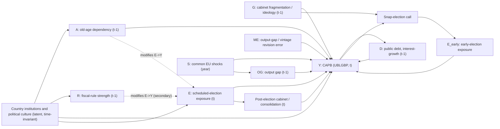

# Capstone Proposal (Stage B): Scheduled Elections, Population Ageing and the Cyclically Adjusted Primary Balance in the EU-27

Status: draft for supervisor review, 2026-10-10. Supporting evidence lives in four appendices under `reports/`:
[A literature matrix](appendix_A_literature_matrix.md) · [B source-to-variable table](appendix_B_source_to_variable.md) · [C repository audit and migration table](appendix_C_repo_migration.md) · [D feasibility probe and gates](appendix_D_feasibility_gates.md).

**Update 2026-10-10:** the researcher's decisions on Stage B are recorded in [docs/decision_log.md](../docs/decision_log.md) and take precedence over this document where they differ (offline-first acquisition, provisional sample period, wording of the ageing interaction, provisional power, literature and fiscal-rule gates, 16-week and 60–80-page planning assumptions). Gate 1–3 inputs are in [acquisition_manifest_2026-10-10.md](acquisition_manifest_2026-10-10.md).

Conventions. **Verified** means seen on an official page, codebook or live metadata response on 2026-10-10 (appendices state the status of every field). Literature statements are abstract-level unless an appendix says otherwise. "Associated with" is used throughout; causal language is reserved for Section 12 and only if its assumptions survive the diagnostics. Open items are collected in Section 23.

---

## 0. Three alternative titles

1. **Scheduled Elections, Population Ageing and the Cyclically Adjusted Primary Balance: Evidence from the EU-27, 1995–2023** *(recommended: states exposure, moderator, outcome, sample)*
2. **Election-Year Fiscal Behaviour in an Ageing Union: A Panel Study of Structural Primary Balances in the EU-27**
3. **Political Budget Cycles Revisited: Scheduled Elections, Demographic Context and the Cyclically Adjusted Primary Balance in the EU-27**

The original working title ("Political Economy of Fiscal Deficits under Demographic Pressure: Dynamic Evidence from European Democracies") is dropped. It promises a dynamic, multi-channel explanation of deficits, which the confirmatory design below deliberately does not attempt.

## 1. Executive abstract

Political budget cycle research asks whether governments loosen fiscal policy before elections. The evidence is large but conditional, and meta-analyses disagree on its size: Philips (2016) reports significant but small average effects, whereas Mandon and Cazals (2019) find little systematic evidence once selective reporting is considered. Most EU studies use headline deficits, spending or composition. Studies with structural-balance outcomes are fewer, and we found none that interacts an election-timing variable with population ageing (a search result, not proof of absence). This capstone asks whether scheduled national elections are associated with deterioration in the cyclically adjusted primary balance (CAPB, European Commission AMECO series UBLGBP, per cent of potential GDP) of EU member states, and whether that association varies with population ageing. The sample is an annual panel of the 27 member states, 1995–2023 (783 country-years, 770 with complete outcome and moderator data). The confirmatory model is a two-way fixed-effects regression with a fractional pre-election exposure for scheduled elections, a within-between decomposition of the old-age dependency ratio, and wild-cluster-bootstrap inference with 27 clusters. Fiscal-rule strength, expenditure components, early elections and real-time CAPB vintages are secondary, pre-specified analyses; prediction is a separate, non-causal module. A simulation-based power calculation on the real election calendar (Gate 3b) finds minimum detectable effects of roughly 0.7 pp of potential GDP for the scheduled-election term and 0.9 pp per standard deviation for the ageing interactions, so an imprecise or null result is the most likely outcome and the design is framed to report it as such (section 21 and the thesis rely on interval estimates, not significance alone). The deliverables are the thesis and a reproducible Python–DuckDB pipeline (Quarto thesis, no R) with source manifests, failing quality gates and a locked analysis extract.

## 2. Problem statement and motivation

Elections create a recurring, calendar-based incentive to shift taxes, transfers and delayed consolidation toward voters. Ageing populations simultaneously raise structural spending pressure (pensions, health, long-term care) and change the electorate. If scheduled elections are associated with weaker structural primary balances, and if the association depends on the age structure, the finding bears on how credible EU fiscal surveillance is likely to be in an ageing Union. If no association is found with a reasonably powered design, that is itself informative given the publication-bias concerns in the meta-analytic literature (Mandon & Cazals 2019; Heinemann et al. 2018).

## 3. Central question and sub-questions

**Central question.** *Are scheduled national elections associated with deterioration in the cyclically adjusted primary balance of EU member states, and does this relationship vary with population ageing?*

| ID | Sub-question | Status |
|---|---|---|
| Q1 | Is pre-election exposure to a scheduled election associated with a lower CAPB, conditional on country and year effects? | Confirmatory |
| Q2 | Does the association differ with the old-age dependency ratio, separately in its between-country and within-country components? | Confirmatory |
| Q3 | Does the CAPB result coincide with changes in primary expenditure, social benefits and revenue (composition)? | Secondary |
| Q4 | Is the association weaker where fiscal-rule strength is higher? | Exploratory (downgraded at Gate 2) |
| Q5 | Do early (unscheduled) elections behave differently, and is the answer robust to how "early" is coded? | Secondary |
| Q6 | Do political and demographic features improve out-of-time prediction of next-year CAPB changes beyond lagged fiscal and macro variables? | Predictive, non-causal |

## 4. Scope and unit of analysis

- **Unit:** country-year, general government, annual.
- **Population:** the 27 EU member states as of 2023. Non-EU European democracies (NO, IS, CH, UK) enter only robustness runs where series are verified comparable; the EC fiscal-rule index covers EU members only (Appendix B §2.5).
- **Period:** 1995–2023. AMECO's last non-forecast year in the Spring 2026 vintage is 2025 (no forecast flag exists; rule: last two years of a Spring vintage are forecasts), but ParlGov and ETAD stop in 2023 and the 12-month pre-election window means exposure for year *t* needs elections through 31 December of *t*+1. **Gate 3a (2026-10-10) therefore sets the confirmatory sample to 1995–2021** (the last year with complete exposure for all 27 countries; 2022 is a sensitivity on trust in ETAD for 22 countries; all 27 country-years of 2023 are incomplete). The "1995–2023" wording elsewhere in this document is superseded by this rule. Details: `reports/gate3_calendar_and_sample.md`.
- **Estimation sample:** Appendix D's 783 country-years (1995–2023) and 770 jointly observed cells were the pre-gate figures. After Gate 3a the final sample is **715 country-years, 1995–2021, 27 countries** (start year 1995 is the lagged-moderator floor; exactly 22 countries are jointly observed in 1995). Missing cells are early years in five accession countries (HR 1995–2000, CY/CZ/SI 1995–96, SK 1995). Sensitivity samples: 2022 extension N = 737; balanced-22 N = 594; dropping unclassified elections removes CY and MT (25 countries, N = 633).
- **Exclusions:** no sub-national units, no forecasts in the estimation sample, no projections in the historical panel.

## 5. Theoretical framework and DAG

### 5.1 Mechanisms

1. **Electoral channel.** Opportunistic incumbents may cut taxes or raise transfers before elections (Nordhaus 1975; Rogoff 1990). Effects are conditional on democratic age, transparency and institutions (Brender & Drazen 2005; Alt & Lassen 2006; Klomp & de Haan 2013).
2. **Timing channel.** Early elections are chosen strategically and respond to the economy (Kayser 2005; Strøm & Swindle 2002), so scheduled and early elections are analysed separately. Afonso, Alves & Leal (2026, working paper) report expenditure effects around regular but not early elections.
3. **Ageing channel, two opposing mechanisms.** (a) A larger old-age share can increase electoral pressure for pensions and transfers (Razin, Sadka & Swagel 2002; Vlandas 2026 on "grey power"). (b) Age-related spending is institutionally rigid, leaving less room for election-year discretion, and Tepe & Vanhuysse (2009) caution against a simple gerontocracy reading. The sign of the interaction is therefore **not predicted**; the test is two-sided.
4. **Institutional channel.** Rules and fiscal councils may dampen cycles (Gootjes, de Haan & Jong-A-Pin 2021; Debrun et al. 2008), but rule effects weaken under endogeneity and publication bias (Heinemann et al. 2018). Secondary only.
5. **Measurement channel.** CAPB depends on the estimated output gap, whose end-of-sample revisions are large (Orphanides & van Norden 2002; Cimadomo 2012).

### 5.2 DAG



The dotted edges mark effect modification, which a DAG cannot draw natively. `U -> E` reflects constitutional term lengths and fixed calendars, which the country effects absorb.

### 5.3 Variable roles

| Role | Variables | Handling |
|---|---|---|
| Exposure | Scheduled-election exposure (Section 9) | Entered; early-election exposure entered jointly in a separate term so it does not contaminate the reference group |
| Outcome | CAPB, UBLGBP | Level (primary); first difference as secondary |
| Effect modifier | Old-age dependency ratio (conventional, OLDDEP1), decomposed within/between | Interacted with exposure |
| Confounders to adjust | Country effects; year effects; lagged debt/GDP; lagged interest-growth differential; euro membership | In baseline; all measured at t−1 or time-invariant |
| Proxy for measurement leakage | Lagged output gap (AVGDGP, t−1) | Included at t−1 only |
| Mediators not to control | Contemporaneous output gap, unemployment, inflation (election-driven fiscal expansion can move them); post-election cabinet composition (t) | Omitted from the primary model; shown as a sensitivity |
| Colliders to avoid | Snap-election call or "government survival" conditioning; selecting on early-election status | Early elections get their own exposure term; no conditioning on survival |
| Determined simultaneously with Y | Output gap, unemployment, inflation, interest costs via debt, revenue and spending composition, cabinet composition | Lagged or omitted; components are secondary outcomes |
| Feedback | Y → debt and interest costs → future Y; Y → early elections | Lagged controls; no dynamic-panel claim without justification |

## 6. Literature review and research gap

Condensed table; the full 100-plus-row matrix with verification status is [Appendix A](appendix_A_literature_matrix.md). Types: PR = peer-reviewed; WP = working paper.

| Strand | Study | Sample | Outcome | Principal result (hedged; abstract-level) | Link |
|---|---|---|---|---|---|
| EU/EMU | Mink & de Haan 2006, PR | Euro area 1999–2004 | Budget deficit | Deficit rises in the election year, not the year before | [DOI](https://doi.org/10.1177/1465116506063706) |
| EU/EMU | Buti & van den Noord 2004, PR | Early EMU years | Discretionary fiscal policy | Genuine discretionary boost at elections | [DOI](https://doi.org/10.1111/j.0021-9886.2004.00527.x) |
| EU/EMU | Efthyvoulou 2012, PR | EU-27, 1997–2008 | Fiscal policy (measure n/s) | Manipulation; larger in euro area | [DOI](https://doi.org/10.1007/s11127-011-9795-x) |
| Structural balance | **Bednář 2019, PR** (**full text read**) | 28 EU countries, 1995–2016, annual | IMF WEO general-government structural balance incl. interest, % potential GDP (not primary, not CAPB; vintage not stated) | Coefficient on the first lag of an election-year dummy −0.414 (SE 0.174; N = 464), system GMM with 20 instruments for 28 countries. Election timing treated as exogenous; scheduled and early elections not distinguished; age-structure control (−0.982, SE 0.585) never interacted. "Fragmentation" in the title means EU cross-country heterogeneity, not party fragmentation | [DOI](https://doi.org/10.1556/032.2019.69.4.3) |
| Real-time | Golinelli & Momigliano 2006, PR | Euro area | Real-time fiscal stance | PBC strong when macro context is favourable; many results do not survive ex-post data | [DOI](https://doi.org/10.1016/j.jpolmod.2006.08.001) |
| Timing | **Afonso, Alves & Leal 2026, WP** | EU-27, quarterly 2000–2024 | Revenue and primary-expenditure components; CAPB descriptive only | Spending rises around **regular** elections, none around early; read in full | [REM WP](https://rem.rc.iseg.ulisboa.pt/wps/pdf/REM_WP_0405_2026.pdf) |
| Conditionality | Brender & Drazen 2005, PR | Large cross-section | Deficit | Cycle driven by new democracies | [DOI](https://doi.org/10.1016/j.jmoneco.2005.04.004) |
| Conditionality | Alt & Lassen 2006, PR | 19 OECD, 1990s | Fiscal balance | Cycles in low-transparency, polarised countries | [DOI](https://doi.org/10.1111/j.1540-5907.2006.00200.x) |
| Conditionality | Klomp & de Haan 2013, PR | About 70 democracies | Fiscal policy | Pooling rejected; short-run, conditional effects | [DOI](https://doi.org/10.1080/00036846.2011.599787) |
| Meta | Philips 2016, PR | 1,198 estimates, 88 studies | Spending, debt, balance | Significant but small | [DOI](https://doi.org/10.1007/s11127-016-0364-1) |
| Meta (null-leaning) | Mandon & Cazals 2019, PR | 1,037 regressions, 46 studies | Mixed | Little systematic evidence once selective reporting is considered | [DOI](https://doi.org/10.1111/joes.12263) |
| Rules × elections | Gootjes, de Haan & Jong-A-Pin 2021, PR | 77 countries, 1984–2015 | Fiscal policy tools | Strong rules dampen PBCs | [DOI](https://doi.org/10.1007/s11127-020-00797-3) |
| Rules (meta) | Heinemann et al. 2018, PR | 30 studies | Fiscal aggregates | Constraining effect weakened by endogeneity and publication bias | [DOI](https://doi.org/10.1016/j.ejpoleco.2017.03.008) |
| Related, not a PBC null | Carnazza, Liberati & Sacchi 2025, PR (**full text read**) | 19 euro-area countries, 1995–2019, annual | Real-time CAPB level, % potential GDP; coefficient on the real-time output gap | Pro-cyclicality (about −0.22, SE 0.042) is not removed by macro, institutional or political variables. An election-date variable and turnout are included without timing structure (coding not stated in the PDF); age dependency enters as a control, never interacted. Several political variables are significant in levels. Not a test of an election-year effect | [DOI](https://doi.org/10.1016/j.ejpoleco.2023.102435) |
| Measurement | Orphanides & van Norden 2002; Cimadomo 2012, PR | US; OECD | Output gap; real-time structural balance | Revisions as large as the gap; real-time plans differ from outturns | [DOI](https://doi.org/10.1162/003465302760556422), [DOI](https://doi.org/10.1111/j.1467-9442.2012.01697.x) |
| Ageing | Tepe & Vanhuysse 2009; Vlandas 2026; Haelg, Potrafke & Sturm 2022, PR | OECD | Pension and social spending levels | Ageing raises aggregate spending; mixed evidence on electoral "grey power" | [DOI](https://doi.org/10.1017/s0143814x0900097x), [DOI](https://doi.org/10.1353/wp.2026.a980470), [DOI](https://doi.org/10.1007/s11127-022-00984-4) |

**Conflicting and null evidence** (Appendix A §2): Klomp & de Haan find little fiscal effect in most democracies; Mandon & Cazals attribute much to selective reporting; Afonso et al. find no early-election cycle; Tepe & Vanhuysse argue against a naive gerontocracy; Carnazza et al. (full text read) find that political variables leave CAPB pro-cyclicality essentially unchanged, which is not a test of an election-year effect (see `reports/literature_fulltext_carnazza.md`).

**Research gap (hedged).** Bednář (2019; full text read) is the closest prior work on a structural balance and election timing (IMF WEO total structural balance including interest, a lagged election-year dummy, timing assumed exogenous, an age-structure control that is never interacted); Afonso et al. (2026) is the closest on scheduled versus early elections. Carnazza et al. (2025) is the nearest CAPB paper with political variables and an age control: it enters an election-date variable (coding not stated in the PDF) and age dependency as separate regressors, never interacted, with no scheduled/early split. In this search we did not find a study that combines (i) a scheduled-election exposure that treats early elections as endogenous, (ii) a CAPB outcome, and (iii) an age-structure interaction in the EU-27. The search used Crossref, OpenAlex, RePEc and the web; it is not a systematic review, and "not found" does not mean "absent". The contribution should be framed as a careful, powered, pre-specified replication-plus-extension, not as a novel discovery.

## 7. Hypotheses

| ID | Statement | Class | Direction | Test |
|---|---|---|---|---|
| **H1** | Pre-election exposure to a scheduled election is associated with a lower CAPB (β_S < 0) | Confirmatory | Negative (two-sided test) | Wild-cluster bootstrap-t on β_S |
| **H2** | The association varies with the old-age dependency ratio (γ ≠ 0), assessed separately for the between-country and within-country components | Confirmatory | **Withheld** (mechanisms conflict, Section 5.1) | Wild-cluster bootstrap-t on γ_B and γ_W |
| S1 | Changes concentrate in primary expenditure and social benefits rather than revenue | Secondary | Exploratory sign | BH-adjusted across outcomes |
| S2 | Fiscal-rule strength attenuates the election association (δ > 0) | **Exploratory (Gate 2 downgrade, 2026-10-10)**; pre-specified restricted variant: 2016–2023, lagged raw `C-FRSI`, "." kept missing | Positive | Interaction, EU-27; promotion back to secondary only if a power check supports it |
| S3 | Early elections show no systematic CAPB pattern | Secondary | Null | Joint model |
| S4 | Results are similar in real-time and ex-post CAPB | Secondary, feasibility-gated | Null | Vintage comparison (Section 15) |
| P1 | Political and demographic features improve rolling-origin prediction of ΔCAPB over lagged baselines | Predictive | Positive | Out-of-time RMSE difference with Diebold–Mariano test |

Familywise control: H1 and H2 form the confirmatory family and are adjusted by Holm; secondary outcomes use Benjamini–Hochberg (1995). Everything else is labelled exploratory and reported with unadjusted values flagged as such. Directions and tests are frozen in a dated commit before any model sees the outcome.

## 8. Data sources and variable operationalisation

Condensed source-to-variable table. The full table, with exact labels, denominators, coverage and 20 data traps, is [Appendix B](appendix_B_source_to_variable.md). Vintage handles refer to the Spring 2026 AMECO release (live update stamp 2026-06-03).

| Variable | Dataset and code | Exact label / definition | Denominator and sign | Observed vs estimated | Transformation | Status |
|---|---|---|---|---|---|---|
| **CAPB (primary outcome)** | AMECO chapter flow `AMECO_CHAPTER17-01`, `UBLGBP` | "Net lending (+) or net borrowing (−) excluding interest of general government adjusted for the cyclical component :- Adjustment based on potential GDP, Excessive deficit procedure" | **% of potential GDP**; **surplus positive** | Always model-estimated; no forecast flag (`OBS_STATUS`=A throughout); forecasts = last two years of Spring vintage | Level; first difference | VERIFIED-OFFICIAL |
| Headline primary balance | AMECO `UBLGIE` (EDP) / `UBLGI` (ESA) | Net lending excluding interest | % of GDP | Last two years forecast | Secondary outcome | VERIFIED-OFFICIAL |
| Net lending | AMECO `UBLG`; Eurostat `gov_10a_main` `B9` | Net lending (+)/borrowing (−) | % of GDP | | Secondary; cross-check | VERIFIED-OFFICIAL |
| Output gap | AMECO `AVGDGP` (**not** `AVGDGT`) | Gap vs potential GDP | % of potential GDP; positive = actual above potential | Estimated | Lagged control | VERIFIED-OFFICIAL |
| Cyclical component | AMECO `UBLGCP` (**not** `UBLGC`) | Cyclical component, potential-GDP basis | % of potential GDP | Estimated | Diagnostic | VERIFIED-OFFICIAL (label) |
| Primary expenditure | Eurostat `gov_10a_main`: `TE` − `D41PAY` | Total expenditure less interest paid | % of GDP | Flags `p`, `b` carried | Secondary outcome | VERIFIED-OFFICIAL |
| Revenue | `gov_10a_main` `TR` | Total general government revenue | % of GDP | | Secondary outcome | VERIFIED-OFFICIAL |
| Social benefits | `gov_10a_main` `D62PAY`, `D632PAY` (the unsuffixed codes return nothing) | Cash benefits; social transfers in kind | % of GDP | | Mechanism check | VERIFIED-OFFICIAL |
| Old-age and social-protection spending | `gov_10a_exp` COFOG `GF1002`, `GF10`, `GF07` | Old age; social protection; health | % of GDP | SK starts 2010; `GF1002` starts 2000/2001 for 11 states | Component analysis (shorter sample) | VERIFIED-OFFICIAL |
| **Moderator (conventional)** | Eurostat `demo_pjanind` `OLDDEP1` | 65+ per 100 persons aged 15–64 | Per 100 | Population at 1 January | Lagged one year; Mundlak split | VERIFIED-OFFICIAL |
| Moderator (economic) | `EOADR` = 100 × mean(`demo_pjanbroad` `Y_GE65` at 1 Jan t, t+1) ÷ (1000 × `lfsa_egan` `Y15-64`, `THS_PER`) | Elderly per 100 employed aged 15–64 | | LFS breaks flagged `b` kept as a column; HR from 2002 | Robustness | Construction proposed; inputs VERIFIED-OFFICIAL |
| **Exposure** | ETAD v1.0.0: `held_date`, `sche_date`, `dif_days`, `timing1`, `timing2`, `reason`, `termlength` | Scheduled date is **judgement-coded**; negative `dif_days` = early | One row per election (not country-year); 264 elections have unknown scheduled date | Observed | Fractional exposure (Section 9) | VERIFIED-OFFICIAL (via article); dataset licence not stated |
| Election cross-check | ParlGov 2024 stable (Döring & Manow, doi:10.7910/DVN/2VZ5ZC) | `view_election.election_date`, `previous_parliament_election_id` | CC0; **no early/scheduled flag; frozen at June 2023** | Observed | Cross-check dates and gaps | VERIFIED-OFFICIAL |
| Fiscal-rule strength (secondary) | EC Fiscal Governance Database, Fiscal Rules Strength Index, 1990–2024 | Coverage, legal strength, monitoring, flexibility | EU-27 only; do not splice with IMF | Annual | Lagged; one methodology vintage | Page VERIFIED; sheet and variable names **NOT VERIFIED** |
| Cabinet ideology / fragmentation (exploratory) | CPDS `gov_left`, `gov_right`, `gov_party`; DPI2023 `execrlc`, `herfgov`, `checks` | Cabinet shares weighted by days; Herfindahl of government parties | CPDS ends 2023; DPI2023 CC BY 4.0 | Observed | Measured at t−1 | VERIFIED-OFFICIAL |
| Democracy quality | V-Dem v16 `v2x_polyarchy`, `v2x_libdem` | Expert-coded indices; CC BY-SA 4.0 | Local raw CSV exists (not in GitHub) | | Heterogeneity only | VERIFIED-OFFICIAL |
| Debt, interest-growth | AMECO `UDGGL`, `UYIGE`; Eurostat `gov_10dd_edpt1` `GD`, `nama_10_gdp` | Gross debt; EDP interest; nominal GDP | | | Lagged controls; (i−g)/(1+g) | Labels VERIFIED-OFFICIAL |
| EU/euro membership | EC pages | Euro adoption dates verified; exact accession days not verified | | | Indicators | Years VERIFIED |

**Corrections to the original prompt, now binding:** the CAPB is `UBLGBP`, not `UBLGIE`; `UBLGC` and `AVGDGT` are trend-GDP variants, so the potential-GDP pair is `UBLGCP` and `AVGDGP`; AMECO unit code 319 is shared between per-cent-of-GDP and per-cent-of-potential-GDP series and only the COMMENT string separates them, so the denominator must be asserted in a test. Country codes differ across sources (Eurostat `EL`, `UK`; AMECO chapter flows `GRC`, `GBR`, **`ROM`**; ISO-2 `GR`/`GB` appear in none of them), so one explicit crosswalk is mandatory.

## 9. Exposure definition and the minimum viable confirmatory specification

### 9.1 Election exposure (frozen before outcomes are touched)

With annual data, a calendar-year dummy misallocates exposure (a March election makes most of the 12 pre-election months fall in the previous year). The primary exposure is therefore **fractional**:

- `W^S_it` = share of the 12 months before a *scheduled* election in country *i* that fall in calendar year *t* (0 ≤ W ≤ 1).
- `W^E_it` = the same for *early* elections (ETAD `timing2` = −1 or `reason` ∈ {7 no-confidence, 9 other}; ParlGov date gaps as cross-check).
- `Post_it` = share of the 12 months after any election that fall in year *t* (to prevent post-election consolidation, a standard concern in the PBC literature, from contaminating the reference group; no specific citation is claimed here).
- Delayed elections and cases ETAD cannot classify (`timing1` = 3, 264 unknown scheduled dates) are listed explicitly in an exclusion table; the primary result is reported with and without them.
- The 12-month window is fixed by theory (the annual budget cycle), not tuned. Alternative windows (6 and 18 months, calendar-year dummies, t+1 lead) are robustness runs. **Window gate:** the construction is committed after review of the election calendar alone, before CAPB is merged.

### 9.2 Primary model (M1)

$$
\text{CAPB}_{it} = \alpha_i + \lambda_t + \beta_S\,W^S_{it} + \beta_E\,W^E_{it} + \rho\,\text{Post}_{it}
+ \gamma_B\,W^S_{it}\,\bar A_i + \gamma_W\,W^S_{it}\,(A_{i,t-1}-\bar A_i)
+ \eta\,A_{i,t-1} + \mathbf{x}_{i,t-1}'\boldsymbol{\delta} + \varepsilon_{it}
$$

- $A$ = OLDDEP1 (standardised on the estimation sample), $\bar A_i$ its country mean, so the interaction splits into a between-country part $\gamma_B$ and a within-country part $\gamma_W$ (Mundlak 1978; Bell & Jones 2015).
- $\mathbf{x}_{i,t-1}$ = lagged output gap, lagged debt/GDP, lagged interest-growth differential, euro membership. Everything is measured before the outcome year.
- **Why the split is required:** after removing country and year effects only 7.4 per cent of the old-age dependency variance remains (SD 1.35 pp, 0.27 standardised units). About 87 per cent of within-country movement and about 90 per cent of the 1995–2023 change are a common upward trend absorbed by year effects. The interaction therefore draws mostly on cross-country differences (SD 3.3 pp), mixed with election-effect drift along that common trend (Appendix D §1). M1 adds `W^S × period` terms (pre-2008 / 2008–2019 / 2020 on) so that $\gamma_W$ is not a time-trend proxy. Expect $\gamma_B$ to be better identified than $\gamma_W$; both are reported.
- **Interaction diagnostics:** binned-kernel linearity and common-support checks (Hainmueller, Mummolo & Xu 2019).
- **Inference:** country-clustered CR1 with t(26) as baseline; wild-cluster bootstrap-t (Cameron, Gelbach & Miller 2008; Roodman et al. 2019) as the headline p-value and CI; Driscoll–Kraay (1998) and CCE (Pesaran 2006) as sensitivity. Effect sizes are reported in pp of potential GDP with 95 per cent confidence intervals, never p-values alone.
- **Reference tests:** modified Wald (groupwise heteroscedasticity), Wooldridge serial-correlation test, Pesaran (2015) cross-section dependence, CIPS (Pesaran 2007) unit-root test on CAPB and OLDDEP1, VIF (>5 flagged), Hausman (1978) FE-versus-RE reported alongside the Mundlak approach.
- **Dynamics:** no lagged dependent variable and no GMM in M1. With T = 29 the Nickell (1981) bias is modest, but instrument proliferation makes difference or system GMM fragile (Roodman 2009); a bias-corrected fixed-effects variant is a secondary check only.
- **Non-absorbing treatment caveat:** elections recur, so the staggered-adoption estimators built for absorbing treatment (Callaway & Sant'Anna 2021; Borusyak, Jaravel & Spiess 2024) do not apply directly. TWFE is the baseline, with the heterogeneity-robust estimator of de Chaisemartin & D'Haultfoeuille (2020) as a candidate for the event-study module, to be confirmed in Stage C. The PL-Capital-Reform TWFE event-study script (single reform year) must not be reused unchanged (remediation R14).

### 9.3 Causal language

Scheduled elections are *predetermined* rather than exogenous: governments know the date and may plan around it, calendars correlate with institutions, some "scheduled" elections follow political disruption, and ETAD's schedule coding is judgemental. We therefore claim only a *conditional association with a predetermined political exposure*, and a causal-leaning reading only if the placebo, lead and pre-trend diagnostics (Rambachan & Roth 2023) support it. The ageing interaction is never given a causal reading.

## 10. Identification-risk register

| # | Risk | Prevention | Diagnostic | Robustness | Residual limitation |
|---|---|---|---|---|---|
| 1 | Snap or strategically timed elections | Separate `W^E`; scheduled-only headline | Compare coefficients; ETAD vs ParlGov dates | Scheduled-only sample; all-elections | Scheduled-date coding is judgemental; 264 unknown |
| 2 | Fiscal variables influence election timing | Lag all controls; never condition on survival | Lead-of-exposure placebo (do future elections predict today's CAPB?) | Leads/lags event study | Fiscal planning around known dates is partly the mechanism |
| 3 | CAPB is model-estimated and revised | Pin one AMECO vintage; log vintage | Vintage-to-vintage correlation; real-time gate | Headline and primary balances; real-time subsample | Ex-post gap embeds later information (Orphanides & van Norden 2002) |
| 4 | Mechanical cyclicality | Outcome is cyclically adjusted; lagged output gap | Residual correlation with output gap | Add unemployment gap; drop crisis years | Adjustment is only as good as the semi-elasticity |
| 5 | Rule adoption responds to fiscal stress | Rules are secondary and described as association | Rule-strength change before/after stress years | Rule presence and strength alternatives | No design for causal rule effects (Heinemann et al. 2018) |
| 6 | Rule presence ≠ enforcement ≠ compliance | EC index only as strength measure | Document what the index measures | Presence dummy; IMF compliance (exploratory) | No verified compliance series |
| 7 | Ageing confounded with country trends and with EU-15/CEE differences | Within-between split; `W × period` | Two-way variance decomposition (gate G1); correlation with EU-15 dummy 0.34 | Economic dependency ratio; median age; 65+ share; `W × income` and `W × EU-15` horse race | Little clean within variation; $\gamma_B$ may proxy for unobserved country traits |
| 8 | Simultaneity (growth, unemployment, inflation) | Lag; omit mediators | VIF; coefficient stability to adding/dropping | Predetermined-only controls | Unavoidable for contemporaneous macro |
| 9 | Crisis breaks (GFC, euro crisis, COVID, energy) | Year effects; shock indicators | Residual plots by era | Drop 2008–12 and 2020–22; era interactions | Heterogeneous crisis exposure not fully absorbed |
| 10 | Cross-country spillovers and common EU shocks | Year effects | Pesaran CD test | CCE; Driscoll–Kraay | Residual spatial dependence |
| 11 | Small-N, 27 clusters; overfitting | Parsimonious M1; wild bootstrap | Cluster-count sensitivity; leave-one-country-out | Randomisation inference over election calendars (candidate) | Asymptotics are approximate |
| 12 | Non-random missingness | Coverage gates; explicit missingness table | Missing-by-country-by-year map | Balanced 22-country subsample | Five accession countries start later |
| 13 | Multiple testing and forking paths | Pre-registration; Holm/BH families | Specification log | Specification curve (exploratory) | Residual researcher degrees of freedom |
| 14 | Non-absorbing, repeated treatment | Use estimators valid for switchers | Compare TWFE with robust estimator | Stacked event windows | Recurring elections still limit staggered-DiD tools |

## 11. Minimum viable confirmatory design (cut line)

If time runs short, the thesis consists of: Tier-1 descriptives; M1 with the Mundlak split; the wild-cluster inference table; the lead/placebo and window robustness; and the diagnostics in Section 9.2. Everything below that line is optional.

| Class | Contents | Cut priority |
|---|---|---|
| **Confirmatory** (H1, H2) | M1; CAPB level; EU-27 1995–2023; scheduled exposure; Mundlak ageing interaction; wild-cluster inference; pre-specified controls; crisis year effects with exclusion tests for 2008–12 and 2020–22 | Never cut |
| **Secondary** (S1–S4) | Headline primary balance, net lending, ΔCAPB; primary expenditure, revenue, social benefits and COFOG components; early-election term; (the rule-strength interaction with the EC index moved to exploratory at Gate 2); real-time CAPB (gated); economic dependency ratio | Cut S4 first, then COFOG |
| **Exploratory** | Triple interaction (election × ageing × rules); nonlinear ageing thresholds; debt-level and EU-15/CEE heterogeneity; euro vs non-euro; cabinet fragmentation and ideology; country typologies; Denmark–Romania case comparison | Labelled exploratory; BH-adjusted if reported |
| **Predictive** (P1) | Rolling-origin and leave-one-country-out forecasts of ΔCAPB with persistence, ridge/elastic-net and gradient-boosted trees; SHAP/ALE for interpretation only | Cut before any secondary analysis |
| **Expendable** | Dashboard or scenario simulator; 2050/2070 demographic scenarios; GNN; system dynamics; synthetic controls (no discrete reform) | Not planned |

## 12. Predictive module (separate, non-causal)

- **Target:** next-year ΔCAPB (continuous). A binary "deterioration" event is an optional secondary target.
- **Benchmarks:** naive persistence; regularised linear model; gradient-boosted trees; optional interpretable GAM.
- **Validation:** expanding-window origin from 2008 forward, with a leave-one-country-out stress test. No random K-fold. Features are lagged to the forecast origin and the AMECO vintage is pinned (a documented limitation: an ex-post CAPB target contains information unavailable to a real forecaster).
- **Reporting:** incremental value of the political and demographic block over a lagged fiscal-and-macro baseline, error by country, era and regime, with calibration and Diebold–Mariano tests. Predictive gains are never described as causal.

## 13. Robustness, diagnostics and falsification tests

1. Alternative fiscal outcomes (headline primary balance, net lending, ΔCAPB, structural balance `UBLGBPS`).
2. Alternative election windows (6, 12, 18 months; calendar-year dummies; lead only) and scheduled-only versus all elections.
3. Exclusion or separate treatment of 2008–2009, 2010–2012, 2020–2021 and 2022–2023.
4. Leave-one-country-out, Ireland 2010 influence (single residual of −27.6 pp inflates σ), and balanced-22 subsample.
5. Euro-area versus non-euro, EU-15 versus accession members, and a debt-level split (Afonso et al. report high-debt countries deviate).
6. SE alternatives: CR1/t(26), wild-cluster bootstrap-t, Driscoll–Kraay, CCE.
7. Placebo election dates (random re-draws preserving each country's spacing) and lead-of-exposure tests.
8. Alternative demographic measures: OLDDEP3, 65+ share, median age, economic dependency ratio; level versus change in ageing.
9. Alternative political codings: ETAD vs ParlGov election dates; exclude unclassified elections.
10. Fiscal-rule alternatives: EC strength index, presence dummy, MTBF index; IMF compliance only as exploratory.
11. Real-time versus final-vintage CAPB (gated; Section 15).
12. Honest reporting of null, unstable or sign-changing results, with a specification curve for the headline coefficient.

## 14. Data architecture and reproducibility design

### 14.1 Acquisition policy (decision required, ADR-001)

`Sandbox/CLAUDE.md` states that the project uses **static, manually downloaded data with no live API calls**. The verification work used live endpoints and the probe script `scripts/feasibility_probe.py` does too. Default for the production pipeline: **offline and file-based.** The user downloads each source once (URLs recorded in `data/raw/<source>/README.md`, including the SDMX-CSV export links documented in Appendix B), files are stored unmodified with SHA-256 manifests, and `src/ingest/` reads only local files. The probe is a throw-away and should be moved to `scripts/probes/` or deleted before the first commit. If you prefer scripted acquisition, R17 specifies an explicit `--allow-network` module instead. **Please confirm (Section 23, item 1).**

### 14.2 Layers and tree

```text
Fiscal_Deficit/
├── data/
│   ├── raw/        # immutable; <source>/ + README.md + manifest.jsonl (url, release/vintage, retrieved, sha256, licence)
│   ├── interim/    # standardised codes, units, flags (bronze -> silver)
│   ├── processed/  # analysis-ready country-year panel (gold), DuckDB + Parquet
│   └── external/   # licensed or manual inputs; LICENSES.md
├── src/{ingest,normalize,features,models,evaluate,export}/
├── config/         # panel.yaml, countries.csv (single crosswalk), sources.yaml
├── scripts/        # run_pipeline.py; probes/ (throw-away)
├── tests/
├── reports/        # proposal.md, appendices, data_audit.md, model_card.md, robustness.md, thesis/ (Quarto)
├── docs/adr/       # ADR-001 acquisition, ADR-002 vintage pinning, ADR-003 exposure definition, ...
├── environment.yml / uv.lock
└── Makefile
```

Medallion mapping: bronze = raw files plus manifest; silver = parsed, typed, flagged long tables with crosswalked ISO codes; gold = the 783-row panel and locked extract. Delta Lake is not used (local static research data); DuckDB and Parquet are the format, a deviation from the global default that should be recorded in ADR-004.

### 14.3 Rules

- **Immutable raw data**, relative paths only (`pathlib`, project root resolved once), seeds set and logged (`np.random.seed(42)` or `default_rng(42)`), pinned `environment.yml`.
- **Vintage pinning:** Spring 2026 AMECO (live stamp 2026-06-03) is the thesis vintage. The Autumn 2026 release is due in mid-November, after which the live database will change; download and hash the Spring 2026 files **now**. The printed date of the archived "Autumn 2025" vintage (3 June 2025) looks wrong and must be checked before any real-time use.
- **Eurostat parsing:** use SDMX-CSV (separate `OBS_FLAG`, negatives preserved); the bulk TSV puts the flag in the value cell (`-5.4 b`), which the author's earlier parser dropped (R01).
- **Tests:** signs and scales (surplus positive; AMECO denominator assertion via COMMENT string), duplicate country-years, impossible dates, panel keys, merge losses (27 × 29 = 783 rows), forecast-year exclusion, flags carried. Failing gates replace warning-only checks (R03).
- **No silent interpolation**; any imputation is declared in the data dictionary.
- **Figures** at 300 dpi with axis labels, units and a source line; a locked analysis extract is hashed and tagged for the final results.
- **Languages:** Python for ingestion, validation, panel econometrics (own vectorised fixed-effects engine, cross-checked against `statsmodels` and `linearmodels`; wild-cluster bootstrap and diagnostics implemented and tested in Python) and machine learning; Quarto with its Python engine for the thesis. No R (researcher decision, 2026-10-10).

### 14.4 Quality gates

| Gate | Condition | Where |
|---|---|---|
| G0 (pre-build) | Scope agreed; sources and codes verified; ADR-001 resolved | Week 1 |
| G1 | Two-way-demeaned SD of OLDDEP1 ≥ 1.0 pp (observed 1.35); amber 0.7–1.0 (interaction via between variation only, Mundlak mandatory) | Week 2 |
| G2 | Election-dummy MDE ≤ 0.50 pp at the observed residual autocorrelation and ≤ 0.75 pp at ρ = 0, using **real** calendars (placeholders gave 0.37 and 0.59); NO-GO above 1.0 pp | Week 3 |
| G3 | CAPB coverage ≥ 97 per cent of cells, every country ≥ 20 observations, ≥ 22 countries from 1995, no forecast years | Week 2 |
| G4 (post-build) | Diff within scope; no unrelated files; model matches the frozen specification; edge cases listed | Each milestone |
| G5 (pre-merge) | Tests and failing gates pass; sentinel review done; remaining uncertainty documented | Each milestone |

The thresholds are proposals, justified from [Appendix D](appendix_D_feasibility_gates.md), and are judgement calls. The probe's MDEs use random four-year placeholder calendars; they fall as autocorrelation rises because a strict four-year dummy is a high-frequency regressor. Real irregular calendars are less periodic, so the ρ = 0 value is the safer planning number.

## 15. Real-time CAPB: feasibility gate, not a promise

Thirty-five zipped AMECO vintages are publicly archived (Spring 2011 to the listed "Autumn 2025"), but zip contents were not opened, so the presence of `UBLGBP` in each is **NOT VERIFIED**. The cyclical-adjustment method is homogeneous only from Autumn 2014 (first tier from Winter 2013, second tier from Autumn 2014), which limits any real-time panel to roughly 2014–2025 vintages and requires mapping each vintage to the information set available before each election.

- **Core:** one pinned vintage, labelled ex-post revised data.
- **Gate (week 4):** open the Autumn 2014 – Autumn 2025 archives for the CAPB series and confirm coverage for ≥ 20 countries. Pass → restricted real-time subsample. Fail → fall back to headline primary balance and expenditure components, and say so.

## 16. Repository audit and file-level reuse plan

All ten repositories are public with default branch `main`, and were live-checked on 2026-10-10. Six local clones are one to three commits behind the remote; the extra commits touch README, brand SVGs and explainer-video assets only, and all 29 candidate files are byte-identical on both sides. **No file is a clean direct copy**; the most valuable assets are patterns. Full migration table (source path, destination, schema, dependencies, tests, licence concern, defects): [Appendix C §3](appendix_C_repo_migration.md).

| Source repo | Reuse class | Candidate | Destination | Action | Must fix (remediation) |
|---|---|---|---|---|---|
| `rd-productivity-eu` | Adaptation | `00_utils.py` (manifest, hash) | `src/ingest/manifest.py` | refactor | Path-depth bug; date-only dedupe, no checksum check (R05) |
| | Adaptation | `05_build_panel.py` (coverage gate, DuckDB bridge) | `src/normalize/build_panel.py`, `src/evaluate/gates.py` | refactor | Gate only warns; five duplicated ISO dicts; `log(clip)` unusable for signed CAPB (R03, R04, R14) |
| | Adaptation | `src/R/00_load.R` | `src/models/py/panel.py` | rewrite in Python (pattern only) | Hard-coded 29/30 country list, years 1998–2024 (R12) |
| | Pattern only | `05_local_projections.R`, `04_system_gmm.R` (really IV/2SLS), `09_robustness.R` | `src/models/py/`, `src/evaluate/` | pattern only (rewrite in Python) | Misleading GMM name (R02); R&D-specific variables |
| `PL-Capital-Reform-DiD` | Adaptation | `scripts/run_r_stages.py` | `scripts/run_pipeline.py` | refactor | Hard-coded R 4.5.1 path; "skip if output exists" ignores input changes (R12) |
| | Adaptation | `export_to_json.py` | `src/export/to_json.py` | refactor | `NaN` emitted as invalid JSON (R11) |
| | Pattern only | `05_did_eventstudy.py` | `src/models/eventstudy_election.py` | pattern | Single-reform TWFE is biased for repeated elections (R14) |
| `EU-Innovation-Panel` | Adaptation | `seed_check.py`, `logging_config.py`, `vocab_guard.py`, `bronze_schema.py`, `pipeline_audit.py` | `src/evaluate/`, `src/utils/`, `src/ingest/contracts.py` | refactor | `time` range rejects 1995–1999; missing `expected_hashes.json` passes (R15, R16) |
| `RO-Administrative-Reform` | Adaptation / pattern | `scripts/r/utils.R` | not migrated (no R in this project) | pattern only | cwd coupling (R12) |
| `Nuclear Sector` | Adaptation | `bootstrap.py`, `duckdb_writer.py`, `conftest.py` | `scripts/bootstrap_db.py`, `src/ingest/duckdb_writer.py` | refactor | NULL-key duplicates, no failed-run log (R13); duplicate `on:` key in `ci.yml` (R08, rewrite) |
| `EU-GNN-Risk-Monitor` | Parser reference only | `extend_eurostat.py` (keeps negatives) | `src/normalize/eurostat_tsv.py` | refactor | **Contains no V-Dem or political data despite README**; `GR`/`EL` inconsistency (R06, R10); GNN not justified at N≈27 |
| `RO-Voting-Prediction` | Do not reuse | `clean_eurostat.py` | n/a | rewrite | **`_strip_flag` drops negatives** (R01) |
| `pip-reform`, `project-for-data-modelling` | Do not reuse | n/a | n/a | n/a | Map UI and 2-D clustering are out of scope |

**Data on disk:** only V-Dem v16 raw (`Spengler-Wallerstein-Dashboard/data/bronze/V-Dem-CY-Core-v16.csv`, 202.5 MB, gitignored, so absent from GitHub). Everything else must be acquired fresh.

**Remediation backlog (R01–R17, acceptance tests in Appendix C §4):** R01 preserve negative values; R02 rename `04_system_gmm.R`; R03 failing coverage gates; R04 central ISO crosswalk including Slovenia (missing from `rd-productivity-eu` Python country list); R05 manifest with checksum comparison; R06 reconcile README claims; R07 add LICENSE and review third-party data redistribution; R08 fix the duplicate `on:` key; R09 lock the Python environment; R10 EL/GR fix; R11 strict JSON; R12 remove hard-coded paths; R13 harden the bronze writer; R14 estimator hygiene for signed CAPB and repeated treatment; R15 audit tooling; R16 widen bronze contracts to 1995–2023; R17 acquisition policy. These fix defects in the source repositories as a separate, optional workstream; the new tree must pass the acceptance tests regardless.

## 17. Expected contributions

**Academic:** a pre-specified, powered test of the scheduled-election association with a structural-balance outcome in the EU-27; a within/between treatment of the ageing moderator that makes explicit how little clean within-country variation exists; a documented comparison of ex-post and (if feasible) real-time CAPB; and transparent reporting of nulls. **Technical:** a reproducible Python–DuckDB pipeline (Quarto thesis, no R) with failing quality gates, vintage manifests, tests and a model card; a documented list of data traps (UBLGBP vs UBLGIE, unit-code ambiguity, ISO-code divergence, frozen political datasets).

## 18. Limitations and ethical considerations

- CAPB is a model estimate, revised each vintage; the thesis uses ex-post data unless the real-time gate passes.
- Scheduled-date coding is judgemental; the political datasets end in 2023; constitutional-term data lack a verified source beyond ETAD `termlength`.
- 27 clusters and a short election history per country (about 7 elections) limit precision; after Gate 3b (real calendar, N = 715) the design cannot reliably detect a scheduled-election effect below about 0.7 pp of potential GDP (0.9–1.0 pp if CAPB were serially uncorrelated), nor ageing heterogeneity below about 0.9 pp per standard deviation; the literature benchmarks of 0.41 and 0.49 pp are detected with only 25–68 per cent power. The earlier 0.4–0.6 pp range used placeholder calendars and is superseded (`reports/gate3_power_update.md`).
- The ageing interaction rests mostly on between-country variation and may proxy for unobserved country traits.
- The sample is the EU-27 only, a mix of long-established and post-1989 democracies; findings should not be extended beyond it.
- Data licences: AMECO terms, ETAD dataset licence, CPDS, IMF and EC Fiscal Governance Database licences are **not verified**; ParlGov is CC0, V-Dem CC BY-SA 4.0, DPI2023 CC BY 4.0, Eurostat reuse with attribution. R07 requires a provider-read licence table before any redistribution of raw files.
- No personal data. Policy reading must not overstate: the thesis does not assess any government's intent.

## 19. Deliverables and acceptance criteria

| # | Deliverable | Definition of done |
|---|---|---|
| 1 | Proposal | This document, reviewed by supervisor |
| 2 | Literature matrix | Appendix A with every row PASS-verified or excluded; Carnazza et al. and Bednář full texts read (2026-10-10) |
| 3 | Repository audit and migration | Appendix C; each migrated file passes its stated tests |
| 4 | Data dictionary | Every variable has code, label, unit, sign, timing, coverage, status; denominators asserted in tests |
| 5 | DAG and mechanism map | Section 5; revised after diagnostics |
| 6 | Pre-registered specification | Hypotheses, windows, controls and tests committed and tagged **before** outcome models run |
| 7 | Country-year panel | 783 rows; gates G1–G3 pass; manifests with SHA-256; locked extract hashed |
| 8 | Baseline econometric script suite | M1 reproduced from a clean clone with one command; seeds logged |
| 9 | Robustness and identification report | Section 13 tests executed, results tabulated, nulls reported |
| 10 | Predictive evaluation | Rolling-origin results with incremental value of the political/demographic block |
| 11 | Final paper | Quarto, bookdown-style cross-references, `references.bib` complete |
| 12 | Model card and data statement | Intended use, limits, vintages, licences |
| 13 | Dashboard (stretch) | Only after deliverables 1–12 are complete |

## 20. Week-by-week plan (assumption: 16 weeks; see Section 23)

Neither `[INSERT DEADLINE]` nor `[INSERT LENGTH LIMIT]` was supplied, so this plan assumes 16 weeks and a conventional MSc thesis. If the deadline is shorter, apply the cut line in Section 11 from the bottom up.

| Week | Work | Gate / output |
|---|---|---|
| 1 | Resolve ADR-001; environment lock; crosswalk (R04); download and hash Spring 2026 AMECO and all raw sources; per-source README and licence table (R07) | G0; raw manifests |
| 2 | Parsers (R01), manifest (R05), gates (R03); build silver/gold panel; coverage and ageing-variation checks | **G1, G3**; data audit |
| 3 | Election calendar: ETAD plus ParlGov cross-check, 2023 end-year handling, exclusion table; freeze exposure definition **without outcome data**; recompute power with real calendars | **G2**; pre-registration tag |
| 4 | Tier-1 descriptives; AMECO archive check for real-time feasibility (Section 15) | Real-time go/no-go |
| 5–6 | M1 with Mundlak split; diagnostics; wild-cluster inference | Confirmatory results |
| 7 | Leads/lags and placebo; robust estimator for non-absorbing treatment | Dynamic evidence |
| 8 | Secondary outcomes (components, social benefits, COFOG); early elections | S1, S3 |
| 9 | Rule-strength module (EC index); economic dependency ratio | S2 |
| 10 | Robustness suite (windows, crises, LOO, SE variants, alternative codings) | Robustness report |
| 11 | Real-time CAPB subsample (if gate passed) | S4 |
| 12 | Predictive module | P1 |
| 13 | One optional extension or buffer | Decision recorded |
| 14–15 | Writing, figures, tables, `references.bib` | Draft thesis |
| 16 | Clean-clone reproduction, model card, data statement, supervisor revisions | Submission |

Writing starts in week 5 and runs in parallel.

## 21. Risk register

| Risk | L | I | Mitigation |
|---|---|---|---|
| Null or imprecise main result | High | Medium | Pre-register; present as informative; report CIs and MDE |
| Weak within-country ageing variation | High | Medium | Mundlak split; accept between-variation reading; G1 amber path |
| Election calendar coding errors | Medium | High | Two sources; exclusion table; manual spot checks of at least 30 elections |
| AMECO vintage drift (Autumn 2026) | High | Medium | Pin and hash Spring 2026 now |
| Real-time archive unusable | Medium | Low | Gated; fall back to headline measures |
| Scope creep | High | High | Cut line, expendable list, weekly G4/G5 review |
| Political data end in 2023 | Certain | Low | Sample ends 2023; hand-coded 2024–25 as sensitivity only |
| Licence issues for committed raw data | Medium | Medium | R07; keep restricted files out of git |
| Tooling defects inherited from old repos | Medium | Medium | Acceptance tests before reuse; R-tasks |
| Time shortage | Medium | High | 16-week assumption to be confirmed; cut order in Section 11 |

## 22. Supervisor-facing pitch

This capstone tests whether scheduled elections are associated with a worse cyclically adjusted primary balance in the EU-27 and whether the relationship varies with population ageing, using a pre-specified two-way fixed-effects design, a within/between split of the ageing moderator, and wild-cluster inference with 27 countries. It treats scheduled elections as predetermined, not exogenous, and plans for a null: a power simulation on the real calendar shows it can reliably detect only effects of about 0.7 pp of potential GDP or more (0.9 pp per standard deviation for the ageing interactions), well above the 0.41–0.49 pp benchmarks in the literature, so inference is framed around interval estimates and bounds. Prior work has headline-deficit or spending outcomes in the EU, with one structural-balance study (Bednář 2019); we did not find an ageing interaction. Fiscal rules, expenditure composition, real-time vintages and prediction are secondary or gated. The technical contribution is a tested, reproducible pipeline with failing gates and documented data traps.

## 23. Open decisions for you

1. **ADR-001: acquisition policy.** Default in this proposal: offline, manually downloaded, hashed raw files; the probe script is throw-away. Confirm, or choose the explicit `--allow-network` module (R17).
2. **Deadline and length limit** (placeholders unfilled). The plan assumes 16 weeks and a standard MSc thesis.
3. **Pin AMECO Spring 2026** and download the SDMX-CSV chapter flows now, before the mid-November Autumn 2026 release replaces the live database. Downloading needs your approval of filename, source and size.
4. **Full texts:** Carnazza, Liberati & Sacchi (2025) has been read in full (resolved; see `reports/literature_fulltext_carnazza.md`). **Bednář (2019) has now been read in full** (`reports/literature_fulltext_bednar.md`): outcome is the WEO total structural balance, timing is treated as exogenous, there is no scheduled/early split and no ageing interaction.
5. **Fiscal-rule moderator:** the EC workbook's sheet and variable names, scope ("national rules only"?) and methodology break were not opened; needs a manual look before S2 is specified.
6. **Constitutional term lengths:** ETAD `termlength` is the only verified source; confirm whether it is adequate or a second source is needed.
7. **Remediation scope:** fix defects in the source repositories (R01–R17), or only in the new tree?

---

## Bibliography (record-level verified; see Appendix A for verification method and exclusions)

*Abstract-level reading unless noted; "WP" = working paper.*

- Afonso, A., Alves, J., & Leal, F. S. (2026). *Exploring political budget cycles in the EU-27* (REM Working Paper 0405-2026). https://rem.rc.iseg.ulisboa.pt/wps/pdf/REM_WP_0405_2026.pdf
- Alt, J. E., & Lassen, D. D. (2006). Transparency, political polarization, and political budget cycles in OECD countries. *American Journal of Political Science, 50*(3), 530–550. https://doi.org/10.1111/j.1540-5907.2006.00200.x
- Bednář, M. (2019). Political budget cycles in the European Union: New evidence of fragmentation. *Acta Oeconomica, 69*(4), 523–547. https://doi.org/10.1556/032.2019.69.4.3 *(full text read)*
- Bell, A., & Jones, K. (2015). Explaining fixed effects. *Political Science Research and Methods, 3*(1), 133–153. https://doi.org/10.1017/psrm.2014.7
- Benjamini, Y., & Hochberg, Y. (1995). Controlling the false discovery rate. *JRSS-B, 57*(1), 289–300. https://doi.org/10.1111/j.2517-6161.1995.tb02031.x
- Borusyak, K., Jaravel, X., & Spiess, J. (2024). Revisiting event-study designs. *Review of Economic Studies, 91*(6), 3253–3285. https://doi.org/10.1093/restud/rdae007
- Brender, A., & Drazen, A. (2005). Political budget cycles in new versus established democracies. *Journal of Monetary Economics, 52*(7), 1271–1295. https://doi.org/10.1016/j.jmoneco.2005.04.004
- Buti, M., & van den Noord, P. (2004). Fiscal discretion and elections in the early years of EMU. *JCMS, 42*(4), 737–756. https://doi.org/10.1111/j.0021-9886.2004.00527.x
- Callaway, B., & Sant'Anna, P. (2021). Difference-in-differences with multiple time periods. *Journal of Econometrics, 225*(2), 200–230. https://doi.org/10.1016/j.jeconom.2020.12.001
- Cameron, A. C., Gelbach, J. B., & Miller, D. L. (2008). Bootstrap-based improvements for inference with clustered errors. *REStat, 90*(3), 414–427. https://doi.org/10.1162/rest.90.3.414
- Carnazza, G., Liberati, P., & Sacchi, A. (2025). Does politics matter? A comparative assessment of discretionary fiscal policies in the euro area. *EJPE, 90*, 102435. https://doi.org/10.1016/j.ejpoleco.2023.102435 *(full text read)*
- Cimadomo, J. (2012). Fiscal policy in real time. *Scandinavian Journal of Economics, 114*(2), 440–465. https://doi.org/10.1111/j.1467-9442.2012.01697.x
- de Chaisemartin, C., & D'Haultfœuille, X. (2020). Two-way fixed effects estimators with heterogeneous treatment effects. *AER, 110*(9), 2964–2996. https://doi.org/10.1257/aer.20181169
- de Haan, J., & Klomp, J. (2013). Conditional political budget cycles: A review of recent evidence. *Public Choice, 157*(3–4), 387–410. https://doi.org/10.1007/s11127-013-0106-6
- Debrun, X., Moulin, L., Turrini, A., Ayuso-i-Casals, J., & Kumar, M. (2008). Tied to the mast? National fiscal rules in the European Union. *Economic Policy, 23*(54), 297–362. https://doi.org/10.1111/j.1468-0327.2008.00199.x
- Driscoll, J. C., & Kraay, A. C. (1998). Consistent covariance matrix estimation with spatially dependent panel data. *REStat, 80*(4), 549–560. https://doi.org/10.1162/003465398557825
- Efthyvoulou, G. (2012). Political budget cycles in the European Union and the impact of political pressures. *Public Choice, 153*(3–4), 295–327. https://doi.org/10.1007/s11127-011-9795-x
- Eslava, M. (2011). The political economy of fiscal deficits: A survey. *Journal of Economic Surveys, 25*(4), 645–673. https://doi.org/10.1111/j.1467-6419.2010.00647.x
- Golinelli, R., & Momigliano, S. (2006). Real-time determinants of fiscal policies in the euro area. *Journal of Policy Modeling, 28*(9), 943–964. https://doi.org/10.1016/j.jpolmod.2006.08.001
- Gootjes, B., de Haan, J., & Jong-A-Pin, R. (2021). Do fiscal rules constrain political budget cycles? *Public Choice, 188*(1–2), 1–30. https://doi.org/10.1007/s11127-020-00797-3
- Haelg, F., Potrafke, N., & Sturm, J.-E. (2022). The determinants of social expenditures in OECD countries. *Public Choice, 193*(3–4), 233–261. https://doi.org/10.1007/s11127-022-00984-4
- Hainmueller, J., Mummolo, J., & Xu, Y. (2019). How much should we trust estimates from multiplicative interaction models? *Political Analysis, 27*(2), 163–192. https://doi.org/10.1017/pan.2018.46
- Hausman, J. A. (1978). Specification tests in econometrics. *Econometrica, 46*(6), 1251–1271. https://doi.org/10.2307/1913827
- Heinemann, F., Moessinger, M.-D., & Yeter, M. (2018). Do fiscal rules constrain fiscal policy? *EJPE, 51*, 69–92. https://doi.org/10.1016/j.ejpoleco.2017.03.008
- Higashijima, M., Shimizu, N., Washida, H., & Yanai, Y. (2025). Election Timing across Autocracy and Democracy (ETAD). *Electoral Studies, 96*, 102964. https://doi.org/10.1016/j.electstud.2025.102964
- Kayser, M. A. (2005). Who surfs, who manipulates? *APSR, 99*(1), 17–27. https://doi.org/10.1017/s0003055405051464
- Klomp, J., & de Haan, J. (2013). Do political budget cycles really exist? *Applied Economics, 45*(3), 329–341. https://doi.org/10.1080/00036846.2011.599787
- Mandon, P., & Cazals, A. (2019). Political budget cycles: Manipulation by leaders versus manipulation by researchers? *Journal of Economic Surveys, 33*(1), 274–308. https://doi.org/10.1111/joes.12263
- Mink, M., & de Haan, J. (2006). Are there political budget cycles in the euro area? *European Union Politics, 7*(2), 191–211. https://doi.org/10.1177/1465116506063706
- Mourre, G., Astarita, C., & Princen, S. (2014). *Adjusting the budget balance for the business cycle: The EU methodology* (European Economy Economic Papers 536). https://ideas.repec.org/p/euf/ecopap/0536.html
- Mundlak, Y. (1978). On the pooling of time series and cross section data. *Econometrica, 46*(1), 69–85. https://doi.org/10.2307/1913646
- Nickell, S. (1981). Biases in dynamic models with fixed effects. *Econometrica, 49*(6), 1417–1426. https://doi.org/10.2307/1911408
- Nordhaus, W. D. (1975). The political business cycle. *Review of Economic Studies, 42*(2), 169–190. https://doi.org/10.2307/2296528
- Orphanides, A., & van Norden, S. (2002). The unreliability of output-gap estimates in real time. *REStat, 84*(4), 569–583. https://doi.org/10.1162/003465302760556422
- Pesaran, M. H. (2006). Estimation and inference in large heterogeneous panels with a multifactor error structure. *Econometrica, 74*(4), 967–1012. https://doi.org/10.1111/j.1468-0262.2006.00692.x
- Pesaran, M. H. (2007). A simple panel unit root test in the presence of cross-section dependence. *Journal of Applied Econometrics, 22*(2), 265–312. https://doi.org/10.1002/jae.951
- Pesaran, M. H. (2015). Testing weak cross-sectional dependence in large panels. *Econometric Reviews, 34*(6–10), 1089–1117. https://doi.org/10.1080/07474938.2014.956623
- Philips, A. Q. (2016). Seeing the forest through the trees: A meta-analysis of political budget cycles. *Public Choice, 168*(3–4), 313–341. https://doi.org/10.1007/s11127-016-0364-1
- Rambachan, A., & Roth, J. (2023). A more credible approach to parallel trends. *Review of Economic Studies, 90*(5), 2555–2591. https://doi.org/10.1093/restud/rdad018
- Razin, A., Sadka, E., & Swagel, P. (2002). The aging population and the size of the welfare state. *Journal of Political Economy, 110*(4), 900–918. https://doi.org/10.1086/340780
- Rogoff, K. (1990). Equilibrium political budget cycles. *AER, 80*(1), 21–36. https://ideas.repec.org/a/aea/aecrev/v80y1990i1p21-36.html
- Roodman, D. (2009). A note on the theme of too many instruments. *OBES, 71*(1), 135–158. https://doi.org/10.1111/j.1468-0084.2008.00542.x
- Roodman, D., Nielsen, M. Ø., MacKinnon, J. G., & Webb, M. D. (2019). Fast and wild: Bootstrap inference in Stata using boottest. *Stata Journal, 19*(1), 4–60. https://doi.org/10.1177/1536867x19830877
- Shi, M., & Svensson, J. (2006). Political budget cycles: Do they differ across countries and why? *Journal of Public Economics, 90*(8–9), 1367–1389. https://doi.org/10.1016/j.jpubeco.2005.09.009
- Strøm, K., & Swindle, S. M. (2002). Strategic parliamentary dissolution. *APSR, 96*(3), 575–591. https://doi.org/10.1017/s0003055402000345
- Tepe, M., & Vanhuysse, P. (2009). Are aging OECD welfare states on the path to gerontocracy? *Journal of Public Policy, 29*(1), 1–28. https://doi.org/10.1017/s0143814x0900097x
- Vlandas, T. (2026). Aging advanced capitalist democracies: The new electoral politics of economic stagnation. *World Politics, 78*(1), 48–90. https://doi.org/10.1353/wp.2026.a980470
- Volkerink, B., & de Haan, J. (2001). Fragmented government effects on fiscal policy. *Public Choice, 109*(3–4), 221–242. https://doi.org/10.1023/a:1013048518308

**Datasets.** European Commission, DG ECFIN (2026). *AMECO database*, Spring 2026 release (update 3 June 2026). Eurostat (2026). `gov_10a_main` (doi:10.2908/GOV_10A_MAIN), `gov_10a_exp`, `demo_pjanind` (doi:10.2908/DEMO_PJANIND), `demo_pjanbroad`, `lfsa_egan`, accessed 2026-10-10. Döring, H., & Manow, P. (2024). ParlGov 2024 stable release, doi:10.7910/DVN/2VZ5ZC. Coppedge, M., et al. (2026). V-Dem v16, doi:10.23696/vdemds26. Cruz, C., Keefer, P., Scartascini, C., & Simpser, A. Database of Political Institutions 2023, doi:10.60966/8tx1xs4i. Armingeon, K., et al. (2025). Comparative Political Data Set 1960–2023. European Commission, DG ECFIN. Fiscal Governance Database (NFR update 5 March 2026).
