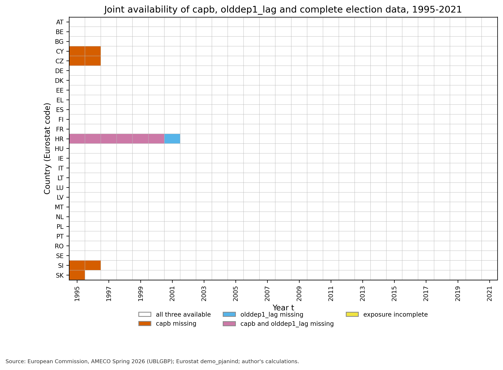
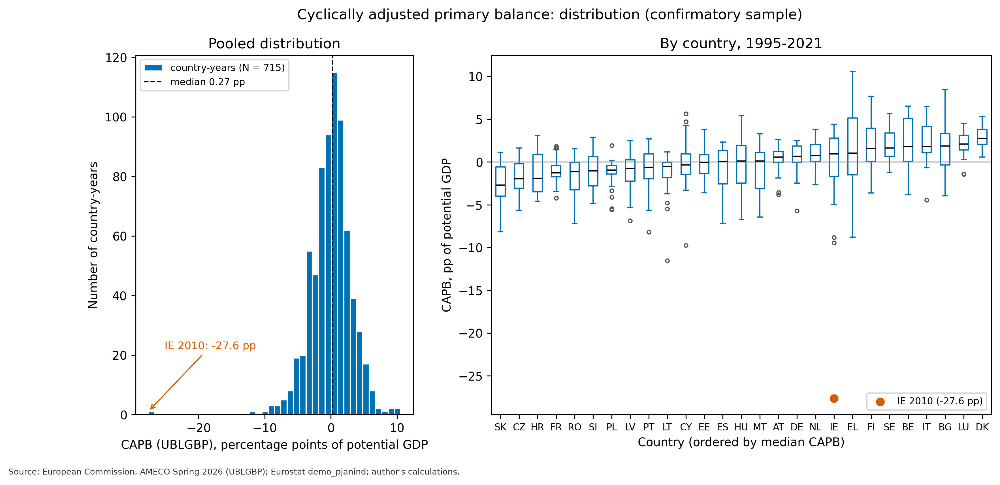
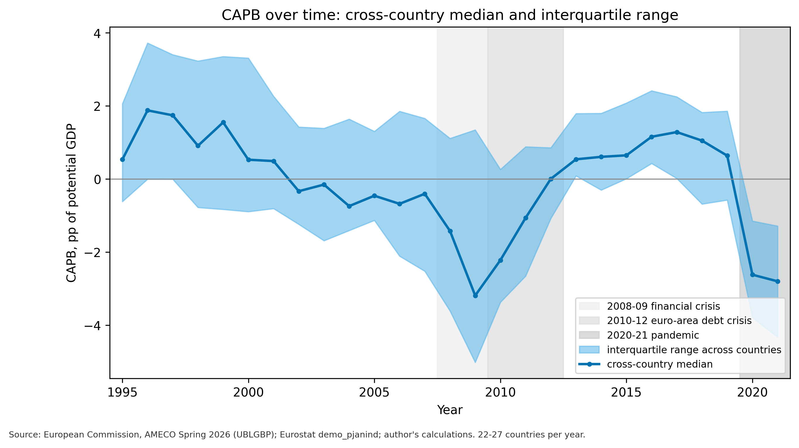
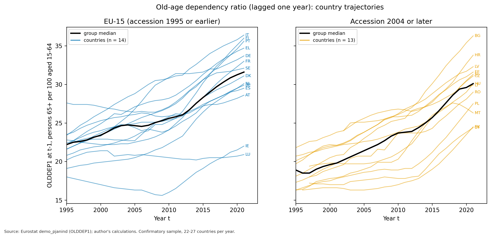
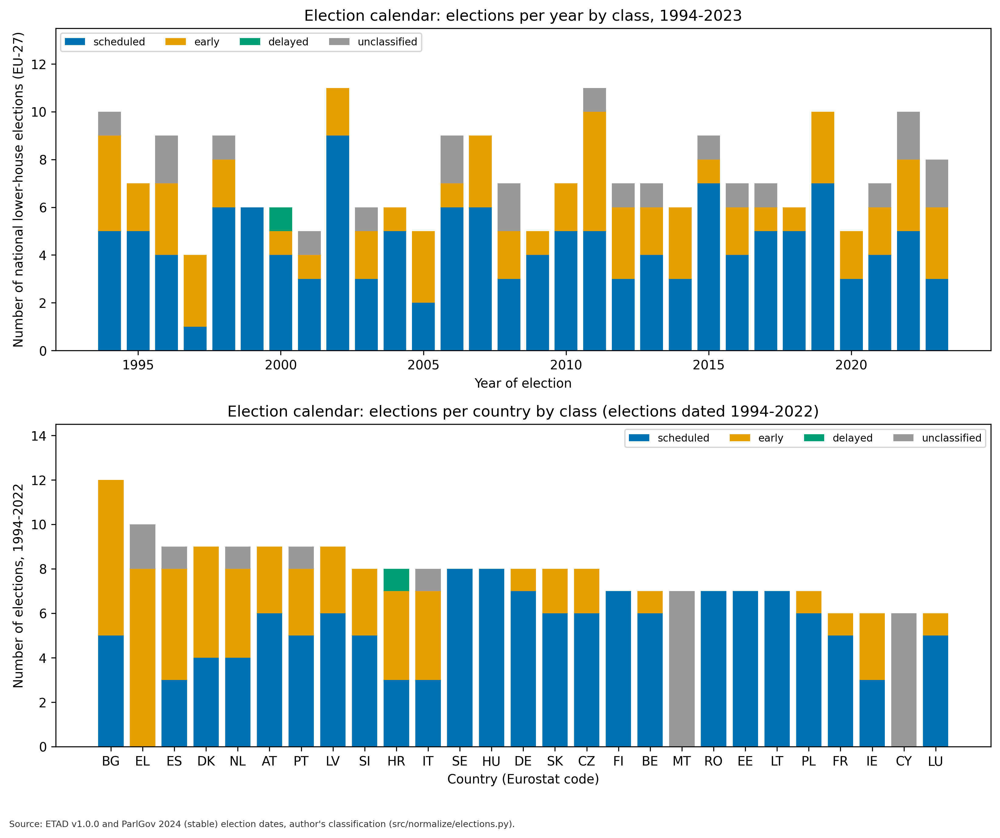
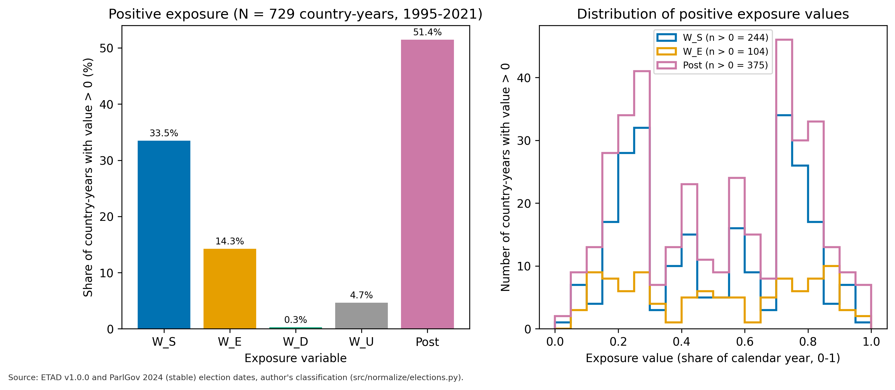
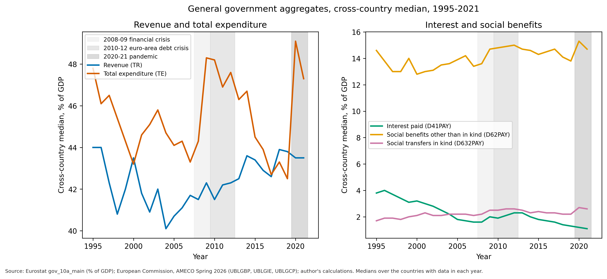
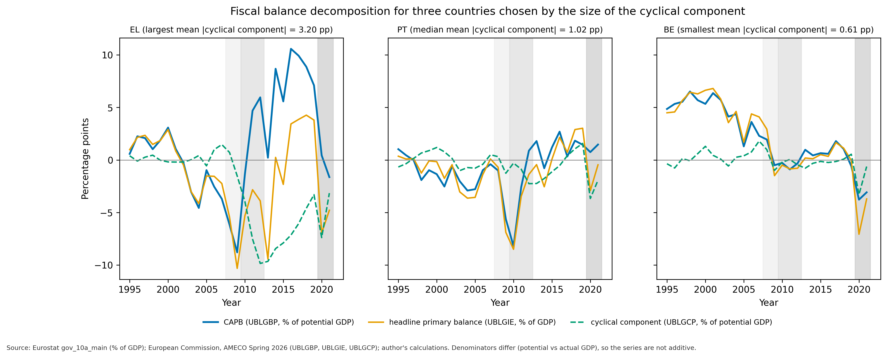
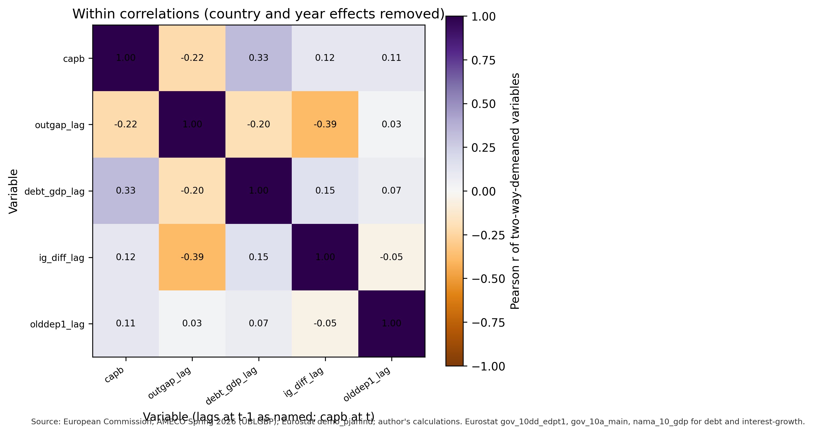

# Tier-1 descriptives (unconditional on elections)

Generated by `python src/evaluate/descriptives.py` (module `src/evaluate/descriptives.py`, tests `tests/test_descriptives.py`) from the gold panel `data/processed/gold/panel_country_year.parquet` (`reports/gold_panel_audit.md`). Offline, deterministic; the only random draw is the persistence simulation (`numpy.random.default_rng(42)`).

**Freeze rule.** The pre-registration freeze (tag `preregistration-v1`) has not happened. No statistic, table or figure below relates CAPB or any secondary fiscal outcome to an election variable (`W_S`, `W_E`, `W_D`, `W_U`, `Post`, election dates, scheduled/early/delayed/unclassified classes). The guard `assert_no_exposure_with_outcome` raises if a routine requests both kinds of column, and every routine reads its inputs through it. Section 5 describes the election calendar on its own. The 715-row sample is defined by data availability and exposure completeness, not by outcome values.

Units: CAPB and the cyclical component are percentage points (pp) of potential GDP, surplus positive; headline primary balance and the aggregates in section 6 are % of GDP; OLDDEP1 is persons aged 65+ per 100 aged 15-64, taken at t-1.

## 1. Coverage and missingness

Joint availability of `capb`, `olddep1_lag` and the cross-validated exposure-completeness flag over 1995-2021 for 27 countries (729 cells): 715 cells have all three; 14 do not. 0 cells are lost to incomplete exposure. Missing cells, by cause:

| eurostat_code | years | n | cause |
|---|---|---|---|
| CY | 1995-1996 | 2 | capb absent from AMECO UBLGBP (series starts later) |
| CZ | 1995-1996 | 2 | capb absent from AMECO UBLGBP (series starts later) |
| HR | 2001 | 1 | OLDDEP1 at t-1 empty in Eurostat (flag e) |
| HR | 1995-2000 | 6 | capb absent from AMECO UBLGBP (series starts later); OLDDEP1 at t-1 empty in Eurostat (flag e) |
| SI | 1995-1996 | 2 | capb absent from AMECO UBLGBP (series starts later) |
| SK | 1995 | 1 | capb absent from AMECO UBLGBP (series starts later) |

Every missing cell lies before the first fully available year of its country (series starting later in AMECO for CY, CZ, SI, SK and HR; empty Eurostat cells for HR). The panel is therefore unbalanced: 22 countries have the full 27-year run; N = 715 country-years.

## 2. CAPB distribution

Confirmatory sample: N = 715, 27 countries, 1995-2021. CAPB has mean 0.04 pp, median 0.27 pp, minimum -27.62 pp, maximum 10.58 pp; 330 of 715 values are negative (skewness -1.12, excess kurtosis 9.00). Variance decomposition of CAPB and, for reference, of the lagged moderator:

| statistic | capb | olddep1_lag |
|---|---|---|
| mean (pp) | 0.037 | 24.378 |
| pooled SD, N - 1 (pp) | 3.096 |  |
| pooled SD, population form (pp) | 3.094 | 4.549 |
| between-country SD (country means, pp) | 1.515 | 3.237 |
| within-country SD (deviation from country mean, pp) | 2.698 | 3.196 |
| two-way SD (country + year effects removed, RSS/N, pp) | 2.383 | 1.246 |
| two-way SD, df-corrected (pp) | 2.477 | 1.295 |
| variance share: between countries | 0.240 | 0.506 |
| variance share: common year effects (after country) | 0.167 | 0.418 |
| variance share: two-way residual | 0.593 | 0.075 |

The two-way SD of CAPB (2.38 pp; 2.48 pp with the degrees-of-freedom correction) is the scale left after removing country and year effects; between-country differences account for 24.0% and common year effects for 16.7% of the variance about the grand mean.

**Largest absolute residual cells** (CAPB regressed on country and year effects only; no election variable). Ireland 2010 (CAPB -27.6 pp, residual -24.1 pp) ranks 1 of 715.

| rank | eurostat_code | year | capb (pp) | two-way residual (pp) |
|---|---|---|---|---|
| 1 | IE | 2010 | -27.62 | -24.12 |
| 2 | LT | 1997 | -11.51 | -11.09 |
| 3 | CY | 2012 | -9.75 | -9.54 |
| 4 | EL | 2009 | -8.79 | -7.98 |
| 5 | IE | 2011 | -9.44 | -7.59 |
| 6 | EL | 2016 | 10.58 | 7.48 |
| 7 | EL | 2017 | 9.92 | 7.09 |
| 8 | EE | 2010 | 3.82 | 6.70 |
| 9 | EL | 2018 | 8.87 | 6.53 |
| 10 | SK | 1996 | -8.14 | -6.52 |

### Persistence of the two-way residual

AR(1) coefficient of the country-and-year-effects residual of CAPB over 688 consecutive-year pairs. The earlier figures come from the full M1 residual (with the election and ageing terms) in `reports/gate3_power_update.md`; the comparison is therefore between two different residuals, and I did not re-derive any effect estimate.

| estimator | this report (country + year effects) | Gate 3b (full M1 residual) |
|---|---|---|
| pooled AR(1), raw two-way residual | 0.601 | 0.594 |
| pooled AR(1), country-standardised | 0.576 | 0.562 |
| Nickell analytic correction (T = 26.5) | 0.642 | 0.627 |
| simulation (indirect-inference) correction, 1000 panels, seed 42 | 0.701 | 0.694 |

Reading: the raw two-way-residual AR(1) is 0.60 (country-standardised 0.58), against 0.59 and 0.56 for the M1 residual; the simulation-corrected value is 0.70 against 0.69. The range of 0.56-0.59 raw and the corrected value of 0.69 are reproduced within 0.03 by the residual that omits all election and ageing terms.

## 3. CAPB over time

| year | n | 25th pct (pp) | median (pp) | 75th pct (pp) |
|---|---|---|---|---|
| 1995 | 22 | -0.62 | 0.53 | 2.06 |
| 1996 | 23 | -0.00 | 1.88 | 3.72 |
| 1997 | 26 | -0.01 | 1.74 | 3.40 |
| 1998 | 26 | -0.78 | 0.91 | 3.23 |
| 1999 | 26 | -0.83 | 1.55 | 3.35 |
| 2000 | 26 | -0.89 | 0.53 | 3.31 |
| 2001 | 26 | -0.81 | 0.49 | 2.26 |
| 2002 | 27 | -1.24 | -0.33 | 1.42 |
| 2003 | 27 | -1.69 | -0.15 | 1.39 |
| 2004 | 27 | -1.41 | -0.74 | 1.64 |
| 2005 | 27 | -1.13 | -0.46 | 1.30 |
| 2006 | 27 | -2.11 | -0.68 | 1.85 |
| 2007 | 27 | -2.52 | -0.41 | 1.66 |
| 2008 | 27 | -3.61 | -1.42 | 1.11 |
| 2009 | 27 | -5.02 | -3.19 | 1.34 |
| 2010 | 27 | -3.38 | -2.22 | 0.26 |
| 2011 | 27 | -2.66 | -1.07 | 0.88 |
| 2012 | 27 | -1.08 | 0.00 | 0.85 |
| 2013 | 27 | 0.09 | 0.54 | 1.79 |
| 2014 | 27 | -0.30 | 0.61 | 1.80 |
| 2015 | 27 | 0.01 | 0.65 | 2.08 |
| 2016 | 27 | 0.43 | 1.16 | 2.42 |
| 2017 | 27 | 0.01 | 1.28 | 2.25 |
| 2018 | 27 | -0.69 | 1.05 | 1.82 |
| 2019 | 27 | -0.58 | 0.64 | 1.86 |
| 2020 | 27 | -3.79 | -2.62 | -1.15 |
| 2021 | 27 | -4.33 | -2.80 | -1.29 |

The cross-country median ranges from -3.19 pp (2009) to 1.88 pp (1996). Shaded bands mark 2008-09, 2010-12 and 2020-21; they are annotations of calendar periods and not variables in any model. The number of countries per year rises from 22 in 1995 to 27.

## 4. Ageing (OLDDEP1 at t-1)

Two-way SD of `olddep1_lag` on the confirmatory sample: **1.246 pp** (0.274 z; df-corrected 1.295 pp); Gate 3a reported 1.246 pp, so the audited figure is confirmed (difference +0.0004 pp). Variance shares: between countries 0.506, common year effects 0.418, two-way residual 0.075 (see the table in section 2). 27 of 27 countries have a higher `olddep1_lag` in their last sample year than in their first; the common year effects account for 41.8% of the variance and the two-way residual for 7.5%.

Cross-country dispersion of `olddep1_lag`, first and last sample year:

| countries | year | n | mean | SD | min | p25 | median | p75 | max | range |
|---|---|---|---|---|---|---|---|---|---|---|
| all countries available in the year | 1995 | 22 | 20.81 | 2.65 | 16.30 | 19.25 | 21.20 | 22.20 | 27.60 | 11.30 |
| all countries available in the year | 2021 | 27 | 30.43 | 4.16 | 20.90 | 28.80 | 31.10 | 33.35 | 36.40 | 15.50 |
| balanced subset (22 countries) | 1995 | 22 | 20.81 | 2.65 | 16.30 | 19.25 | 21.20 | 22.20 | 27.60 | 11.30 |
| balanced subset (22 countries) | 2021 | 22 | 30.75 | 4.16 | 20.90 | 29.12 | 30.60 | 33.53 | 36.40 | 15.50 |

The cross-country SD changes by a factor 1.57 between 1995 and 2021 across all available countries (22 in 1995, 27 in 2021) and 1.57 in the balanced subset. Group medians:

| group | countries | median 1995 | n 1995 | median 2021 | n 2021 |
|---|---|---|---|---|---|
| Accession 2004 or later | 13 | 18.90 | 8 | 30.10 | 13 |
| EU-15 (accession 1995 or earlier) | 14 | 22.20 | 14 | 31.60 | 14 |

## 5. The election calendar on its own (outcome-free)

The calendar holds 248 national lower-house elections 1990-2023 (scheduled 143, early 75, delayed 1, unclassified 29); dated 1994 or later: scheduled 135, early 64, delayed 1, unclassified 21. Elections per year by class (election date year):

| year | scheduled | early | delayed | unclassified | total |
|---|---|---|---|---|---|
| 1994 | 5 | 4 | 0 | 1 | 10 |
| 1995 | 5 | 2 | 0 | 0 | 7 |
| 1996 | 4 | 3 | 0 | 2 | 9 |
| 1997 | 1 | 3 | 0 | 0 | 4 |
| 1998 | 6 | 2 | 0 | 1 | 9 |
| 1999 | 6 | 0 | 0 | 0 | 6 |
| 2000 | 4 | 1 | 1 | 0 | 6 |
| 2001 | 3 | 1 | 0 | 1 | 5 |
| 2002 | 9 | 2 | 0 | 0 | 11 |
| 2003 | 3 | 2 | 0 | 1 | 6 |
| 2004 | 5 | 1 | 0 | 0 | 6 |
| 2005 | 2 | 3 | 0 | 0 | 5 |
| 2006 | 6 | 1 | 0 | 2 | 9 |
| 2007 | 6 | 3 | 0 | 0 | 9 |
| 2008 | 3 | 2 | 0 | 2 | 7 |
| 2009 | 4 | 1 | 0 | 0 | 5 |
| 2010 | 5 | 2 | 0 | 0 | 7 |
| 2011 | 5 | 5 | 0 | 1 | 11 |
| 2012 | 3 | 3 | 0 | 1 | 7 |
| 2013 | 4 | 2 | 0 | 1 | 7 |
| 2014 | 3 | 3 | 0 | 0 | 6 |
| 2015 | 7 | 1 | 0 | 1 | 9 |
| 2016 | 4 | 2 | 0 | 1 | 7 |
| 2017 | 5 | 1 | 0 | 1 | 7 |
| 2018 | 5 | 1 | 0 | 0 | 6 |
| 2019 | 7 | 3 | 0 | 0 | 10 |
| 2020 | 3 | 2 | 0 | 0 | 5 |
| 2021 | 4 | 2 | 0 | 1 | 7 |
| 2022 | 5 | 3 | 0 | 2 | 10 |
| 2023 | 3 | 3 | 0 | 2 | 8 |

Elections per country by class among those that can touch exposure in 1995-2021 (dated 1994-01-01 to 2022-12-31), sorted by the number of scheduled elections:

| eurostat_code | scheduled | early | delayed | unclassified | total |
|---|---|---|---|---|---|
| CY | 0 | 0 | 0 | 6 | 6 |
| EL | 0 | 8 | 0 | 2 | 10 |
| MT | 0 | 0 | 0 | 7 | 7 |
| ES | 3 | 5 | 0 | 1 | 9 |
| HR | 3 | 4 | 1 | 0 | 8 |
| IE | 3 | 3 | 0 | 0 | 6 |
| IT | 3 | 4 | 0 | 1 | 8 |
| DK | 4 | 5 | 0 | 0 | 9 |
| NL | 4 | 4 | 0 | 1 | 9 |
| BG | 5 | 7 | 0 | 0 | 12 |
| FR | 5 | 1 | 0 | 0 | 6 |
| LU | 5 | 1 | 0 | 0 | 6 |
| PT | 5 | 3 | 0 | 1 | 9 |
| SI | 5 | 3 | 0 | 0 | 8 |
| AT | 6 | 3 | 0 | 0 | 9 |
| BE | 6 | 1 | 0 | 0 | 7 |
| CZ | 6 | 2 | 0 | 0 | 8 |
| LV | 6 | 3 | 0 | 0 | 9 |
| PL | 6 | 1 | 0 | 0 | 7 |
| SK | 6 | 2 | 0 | 0 | 8 |
| DE | 7 | 1 | 0 | 0 | 8 |
| EE | 7 | 0 | 0 | 0 | 7 |
| FI | 7 | 0 | 0 | 0 | 7 |
| LT | 7 | 0 | 0 | 0 | 7 |
| RO | 7 | 0 | 0 | 0 | 7 |
| HU | 8 | 0 | 0 | 0 | 8 |
| SE | 8 | 0 | 0 | 0 | 8 |

Fewest scheduled elections: CY, EL, MT (0 each). Cyprus and Malta are absent from ETAD, so their elections are all unclassified.

### Unclassified elections dated 1994 or later: 21

Of these, 19 fall on or before 2022-12-31 and can enter the 1995-2021 exposure; the remaining 2 are 2023 elections.

| eurostat_code | date_used | class_primary | rule | gap-based class |
|---|---|---|---|---|
| CY | 1996-05-26 | unclassified | no_etad_row | scheduled |
| CY | 2001-05-27 | unclassified | no_etad_row | scheduled |
| CY | 2006-05-21 | unclassified | no_etad_row | scheduled |
| CY | 2011-05-22 | unclassified | no_etad_row | scheduled |
| CY | 2016-05-22 | unclassified | no_etad_row | scheduled |
| CY | 2021-05-30 | unclassified | no_etad_row | scheduled |
| EL | 2012-06-17 | unclassified | timing1_unknown | early |
| EL | 2015-09-20 | unclassified | timing1_unknown | early |
| EL | 2023-05-21 | unclassified | no_etad_row | scheduled |
| EL | 2023-06-25 | unclassified | no_etad_row | early |
| ES | 2008-03-09 | unclassified | delayed_vs_dif_days_sign | scheduled |
| IT | 2006-04-09 | unclassified | delayed_vs_early_reason | scheduled |
| MT | 1996-10-26 | unclassified | no_etad_row | scheduled |
| MT | 1998-09-05 | unclassified | no_etad_row | early |
| MT | 2003-04-12 | unclassified | no_etad_row | scheduled |
| MT | 2008-03-08 | unclassified | no_etad_row | scheduled |
| MT | 2013-03-09 | unclassified | no_etad_row | scheduled |
| MT | 2017-06-03 | unclassified | no_etad_row | early |
| MT | 2022-03-26 | unclassified | no_etad_row | scheduled |
| NL | 1994-05-03 | unclassified | delayed_vs_early_reason | delayed |
| PT | 2022-01-30 | unclassified | delayed_vs_dif_days_sign | early |

Distribution of the exposure variables (share of the calendar year inside the window; 0-1) over the 729 country-years of 1995-2021, and over the 715-row confirmatory sample:

| variable | n country-years | share > 0 (%) | mean | SD | median | p90 | max | mean if > 0 | share = 1 (%) | sample |
|---|---|---|---|---|---|---|---|---|---|---|
| W_S | 729 | 33.471 | 0.167 | 0.278 | 0.000 | 0.727 | 0.967 | 0.499 | 0.000 | window 729 |
| W_E | 729 | 14.266 | 0.073 | 0.208 | 0.000 | 0.283 | 1.000 | 0.512 | 0.137 | window 729 |
| W_D | 729 | 0.274 | 0.001 | 0.037 | 0.000 | 0.000 | 0.995 | 0.500 | 0.000 | window 729 |
| W_U | 729 | 4.664 | 0.024 | 0.119 | 0.000 | 0.000 | 0.921 | 0.520 | 0.000 | window 729 |
| Post | 729 | 51.440 | 0.263 | 0.318 | 0.098 | 0.779 | 1.000 | 0.512 | 0.549 | window 729 |

| variable | n country-years | share > 0 (%) | mean | SD | median | p90 | max | mean if > 0 | share = 1 (%) | sample |
|---|---|---|---|---|---|---|---|---|---|---|
| W_S | 715 | 33.566 | 0.168 | 0.278 | 0.000 | 0.728 | 0.967 | 0.499 | 0.000 | confirmatory 715 |
| W_E | 715 | 14.406 | 0.073 | 0.208 | 0.000 | 0.285 | 1.000 | 0.509 | 0.140 | confirmatory 715 |
| W_D | 715 | 0.000 | 0.000 | 0.000 | 0.000 | 0.000 | 0.000 |  | 0.000 | confirmatory 715 |
| W_U | 715 | 4.476 | 0.023 | 0.117 | 0.000 | 0.000 | 0.921 | 0.522 | 0.000 | confirmatory 715 |
| Post | 715 | 51.329 | 0.263 | 0.317 | 0.098 | 0.777 | 1.000 | 0.512 | 0.559 | confirmatory 715 |

Share of country-years with a positive pre-election exposure of any class: 51.2% of 729 (window) and 50.9% of 715 (confirmatory); with a positive `Post`: 51.4% and 51.3%; positive pre-election or post exposure: 75.2% and 75.0%. `W_D` is positive in 2 country-years of the window (the single delayed election is HR 2000-01-03).

## 6. Secondary fiscal aggregates

| year | Revenue (TR) | Total expenditure (TE) | Interest paid (D41PAY) | Social benefits other than in kind (D62PAY) | Social transfers in kind (D632PAY) | n_countries |
|---|---|---|---|---|---|---|
| 1995 | 44.00 | 47.80 | 3.80 | 14.60 | 1.70 | 27 |
| 1996 | 44.00 | 46.10 | 4.00 | 13.80 | 1.90 | 27 |
| 1997 | 42.30 | 46.50 | 3.70 | 13.00 | 1.90 | 27 |
| 1998 | 40.80 | 45.40 | 3.40 | 13.00 | 1.80 | 27 |
| 1999 | 42.00 | 44.30 | 3.10 | 14.00 | 2.00 | 27 |
| 2000 | 43.50 | 43.20 | 3.20 | 12.80 | 2.10 | 27 |
| 2001 | 41.80 | 44.60 | 3.00 | 13.00 | 2.30 | 27 |
| 2002 | 40.90 | 45.10 | 2.80 | 13.10 | 2.10 | 27 |
| 2003 | 42.00 | 45.80 | 2.50 | 13.50 | 2.10 | 27 |
| 2004 | 40.10 | 44.70 | 2.20 | 13.60 | 2.20 | 27 |
| 2005 | 40.70 | 44.10 | 1.80 | 13.90 | 2.20 | 27 |
| 2006 | 41.10 | 44.30 | 1.70 | 14.20 | 2.20 | 27 |
| 2007 | 41.70 | 43.30 | 1.60 | 13.40 | 2.10 | 27 |
| 2008 | 41.50 | 44.30 | 1.60 | 13.60 | 2.20 | 27 |
| 2009 | 42.30 | 48.30 | 2.00 | 14.70 | 2.50 | 27 |
| 2010 | 41.50 | 48.20 | 1.90 | 14.80 | 2.50 | 27 |
| 2011 | 42.20 | 46.90 | 2.10 | 14.90 | 2.60 | 27 |
| 2012 | 42.30 | 47.60 | 2.30 | 15.00 | 2.60 | 27 |
| 2013 | 42.50 | 46.30 | 2.30 | 14.70 | 2.50 | 27 |
| 2014 | 43.60 | 46.70 | 2.00 | 14.60 | 2.30 | 27 |
| 2015 | 43.40 | 44.50 | 1.80 | 14.30 | 2.40 | 27 |
| 2016 | 42.90 | 43.90 | 1.70 | 14.50 | 2.30 | 27 |
| 2017 | 42.60 | 42.70 | 1.60 | 14.70 | 2.30 | 27 |
| 2018 | 43.90 | 43.30 | 1.40 | 14.10 | 2.20 | 27 |
| 2019 | 43.80 | 42.50 | 1.30 | 13.80 | 2.20 | 27 |
| 2020 | 43.50 | 49.10 | 1.20 | 15.30 | 2.70 | 27 |
| 2021 | 43.50 | 47.30 | 1.10 | 14.70 | 2.60 | 27 |

Cross-country medians, % of GDP, over the countries with data in each year (Eurostat `gov_10a_main`).

### Decomposition for three illustrative countries

Rule fixed in advance: rank countries by the mean absolute cyclical component (AMECO UBLGCP, pp of potential GDP) over 1995-2021 and take the largest, the smallest and the (lower) median. Selected: BE (smallest, 0.61 pp), PT (median, 1.02 pp), EL (largest, 3.20 pp). The rule uses no election variable.

| eurostat_code | mean abs cyclical component (pp) | years | pick |
|---|---|---|---|
| BE | 0.61 | 27 | smallest |
| DE | 0.62 | 27 |  |
| AT | 0.70 | 27 |  |
| BG | 0.76 | 27 |  |
| SE | 0.77 | 27 |  |
| MT | 0.77 | 27 |  |
| CZ | 0.82 | 25 |  |
| SK | 0.84 | 26 |  |
| LU | 0.86 | 27 |  |
| PL | 0.87 | 27 |  |
| RO | 0.87 | 27 |  |
| NL | 0.97 | 27 |  |
| HU | 0.97 | 27 |  |
| PT | 1.02 | 27 | median |
| FI | 1.06 | 27 |  |
| FR | 1.07 | 27 |  |
| IT | 1.21 | 27 |  |
| LV | 1.27 | 27 |  |
| DK | 1.31 | 27 |  |
| HR | 1.34 | 21 |  |
| LT | 1.37 | 27 |  |
| IE | 1.41 | 27 |  |
| CY | 1.45 | 25 |  |
| SI | 1.49 | 25 |  |
| EE | 1.51 | 27 |  |
| ES | 2.31 | 27 |  |
| EL | 3.20 | 27 | largest |

CAPB is expressed in % of potential GDP and the headline primary balance (UBLGIE, EDP basis) in % of GDP, so the three series are not additive; the figure shows their co-movement only.

## 7. Within correlations and multicollinearity (no exposure variable)

Pearson correlations of two-way-demeaned (country and year effects removed) variables, each pair on its own pairwise-complete rows of the confirmatory sample. Intervals are naive Fisher-z intervals that ignore clustering and the fixed-effects degrees of freedom; they are descriptive.

| variable A | variable B | n | r (within) | 95% CI low | 95% CI high |
|---|---|---|---|---|---|
| capb | outgap_lag | 703 | -0.224 | -0.293 | -0.153 |
| capb | debt_gdp_lag | 688 | 0.329 | 0.260 | 0.394 |
| capb | ig_diff_lag | 664 | 0.116 | 0.040 | 0.190 |
| capb | olddep1_lag | 715 | 0.110 | 0.037 | 0.182 |
| outgap_lag | debt_gdp_lag | 684 | -0.197 | -0.268 | -0.124 |
| outgap_lag | ig_diff_lag | 661 | -0.385 | -0.448 | -0.319 |
| outgap_lag | olddep1_lag | 703 | 0.025 | -0.049 | 0.099 |
| debt_gdp_lag | ig_diff_lag | 664 | 0.146 | 0.070 | 0.219 |
| debt_gdp_lag | olddep1_lag | 688 | 0.070 | -0.004 | 0.144 |
| ig_diff_lag | olddep1_lag | 664 | -0.048 | -0.123 | 0.029 |

VIF of the two-way-demeaned regressors (the diagonal of the inverse correlation matrix), exposure terms excluded; VIF above 5 would be flagged for discussion. This is a partial check: the VIF of the full M1 design including the exposure terms and interactions is deferred until after the freeze.

continuous regressors (olddep1_lag, outgap_lag, debt_gdp_lag, ig_diff_lag):

| regressor | VIF (within) | flag | n |
|---|---|---|---|
| olddep1_lag | 1.02 |  | 661 |
| outgap_lag | 1.38 |  | 661 |
| debt_gdp_lag | 1.21 |  | 661 |
| ig_diff_lag | 1.18 |  | 661 |

registered robustness model (olddep1_lag, outgap_lag, euro_member):

| regressor | VIF (within) | flag | n |
|---|---|---|---|
| olddep1_lag | 1.00 |  | 703 |
| outgap_lag | 1.02 |  | 703 |
| euro_member | 1.02 |  | 703 |

## 8. What these descriptives do not show

* They do not relate CAPB, or any secondary outcome, to any election variable: no election-window plot, event study, outcome-on-election regression or group mean of CAPB by exposure appears here. Every election-related statement about fiscal outcomes is deferred until after the freeze (`preregistration-v1`).
* Section 5 describes the calendar by itself; it says nothing about fiscal behaviour around elections.
* The crisis bands are calendar annotations. Co-movement of the cross-country median with them is not evidence about any mechanism.
* The within correlations are associations between variables with country and year effects removed; they are not causal and ignore clustering. The VIF check is partial.
* The persistence comparison uses a different residual than Gate 3b (no election or ageing terms), so equality of the numbers is not expected.
* The sample is unbalanced (14 country-years at the start of five countries' series are absent), and CAPB is a model-based Commission estimate that is revised between vintages.
